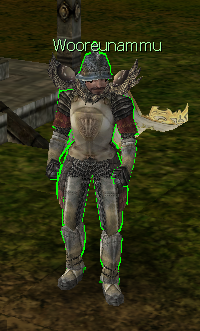

# Mudança de Classe e Mudança de Corpo

> **Class Change and Body Change.** Explains changing a character's class through the NPC Wooreunammu in Kefra (Sephirot of the target class plus 100kk) or with the Sephiroth Blessing item, which unlearns all Sephira skills. A body change uses the Sephiroth Protection item, and both items come from the Global server's monthly events.

**Mudança de classe:**
Existe 2 formas de realizar esse procedimento em seu personagem:

**1- NPC Wooreunammu**

Para mudar a classe dos personagens, vá em Kefra e procure o NPC Wooreunammu (X:3230 Y:1683).

Para realizar a troca de cada classe, são necessários:

* Sephirot da Classe desejada
* 100kk

Equipe o Sephirot e clique no NPC, após isso a classe será Alterada.

O Fafão criou um vídeo para ajudar no entendimento desse procedimento. Para assisti-lo, [clique aqui](https://www.youtube.com/watch?v=AZIi8x2SMp8)!

**2 - Sephiroth Blessing:**

Para mudar a classe do personagem, equipe a Sephiroth da classe desejada e ative o item Sephiroth Blessing.

-> O item Sephiroth Blessing pode ser adquirido nos eventos mensais do servidor Global.

-> **IMPORTANTE: Ao alterar a classe todas as skills sephira serão desaprendidas!**

---

**Mudança de corpo:**

Para realizar esse procedimento, equipe a Sephiroth da classe desejada e ative o item Sephiroth Protection.

-> O item Sephiroth Protection pode ser adquirido nos eventos mensais do servidor Global.

-> Para realizar o procedimento da mudança de corpo, é necessário remover os equipamentos do personagem.

## Fontes

- [GUIA: Mudança de classe e mudança de corpo](https://feedback.kersef.com/pt-br/knowledge-bases/21/articles/23390-guia-mudanca-de-classe-e-mudanca-de-corpo), FAQ WYD Global (feedback.kersef.com). Cópia arquivada: [23390-guia-mudanca-de-classe-e-mudanca-de-corpo.md](../../sources/feedback_kersef/data/articles/markdown/23390-guia-mudanca-de-classe-e-mudanca-de-corpo.md)
