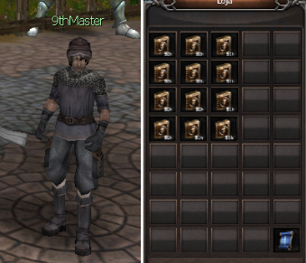
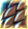
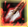
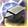
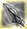
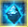
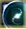

# Nona Skill (9th)

> Lista as 9ª skills de cada classe, compradas no NPC 9thMaster em Armia e aprendidas a partir do nível 201 por personagens Celestial e Sub-Celestial por 255 pontos de skill. Só é possível aprender a 9ª da mesma linhagem da 8ª; ela eleva o limite de maestria para 320 e pode ser desaprendida com o Círculo Divino Composto.

## Nona Skill - 9th

As 9th podem ser aprendidas por todos os personagens e são encontradas no NPC 9thMaster (X:2136 Y:2115), localizado na Cidade de Armia. As skills podem ser adquiridas em troca de ouro (Confirme o valor antes de comprar).

-> Os livros de 9th também podem ser adquiridos através de eventos e promoções, além do mercado entre jogadores.
-> Apenas é possível aprender a 9th da mesma linhagem da 8th.

-> Ao aprender a 9th, o limite máximo de pontos de maestria é aumentado para 320.

-> A 9th pode ser desaprendida utilizado o Círculo Divino Composto.

-> A 9th pode ser aprendida a partir do level 201 em personagens Celestiais / Subcelestiais.

Para cada classe de cada personagem existe uma 9th diferente.

-> São necessários 255 pontos de skill para aprender a habilidade.

##### BeastMaster:

Elemental - Anti-Magia (Buff)

Ao usar essa habilidade, um escudo é criado a sua volta, podendo se esquivar de magias. Quanto mais ponto nesta linhagem, maior será a duração do efeito.

Evocação - Unidade Mental (Passiva)

Ao aprender essa habilidade, suas evocações se tornarão mais poderosas.

Natureza - Concha Resistente (Passiva)

Reduz a chance de receber ataques críticos.

##### TransKnight:

Confiança - Proteção Divina (Buff)

Ao usar essa habilidade, o personagem se tornará invulnerável por certo período e amplificará a cura da skill "Aura de Cura" (10% dos pontos em INT).

Trans - Mãos Sangrentas (Passiva)

Ao usar duas armas de uma mão e acertar um ataque crítico, existe uma chance de regenerar uma pequena quantidade de HP.

Espada mágica - Espelho Mágico (Passiva)

Aumento na chance de acertar um ataque mágico no oponente.

##### Huntress:

Sobrevivência - Contra Ataque (Passiva)

Após se esquivar de um ataque, o seu próximo ataque será aumentado.

Troca - Ponto do Mestre (Passiva)

Ao aprender essa habilidade, o poder de Alquimia de seu personagem será ampliado, aumentando a chance de sucesso na composição de jóias.

Captura - Tiro Direto (Passiva)

O primeiro ataque após sair da invisibilidade irá causar um bônus de dano proporcional ao HP do alvo. Adicionalmente, o ataque irá paralisar o alvo e reduzir a capacidade de absorção da skill “controle de mana” durante um curto período de tempo.

##### Foema:

Magia Branca - Cenote (Passiva)

Adiciona uma probabilidade de aumentar a cura recebida por membros do grupo (crítico de cura).

Magia Negra - Magia Misteriosa (Buff)

Ao usar essa habilidade, seus ataques causam maior dano e o custo de mana das skills será aumentado.

Magia Especial - Remover Memória

Ao usar a habilidade ‘CANCELAMENTO’, existirá a chance do alvo ser incapacitado de mover-se. Contudo, ainda poderá usar suas habilidades.

## Fontes

- [Nona Skill - (9th)](https://feedback.kersef.com/pt-br/knowledge-bases/21/articles/67187-nona-skill-9th), FAQ WYD Global (feedback.kersef.com). Cópia arquivada: [67187-nona-skill-9th.md](../../sources/feedback_kersef/data/articles/markdown/67187-nona-skill-9th.md)
