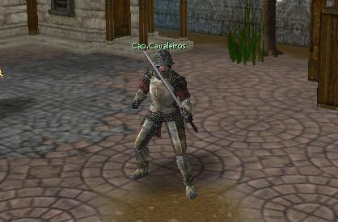
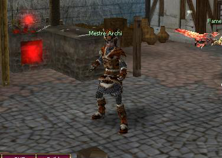
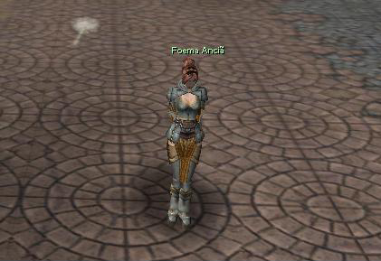
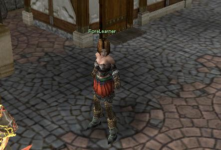
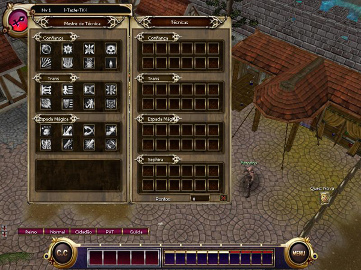
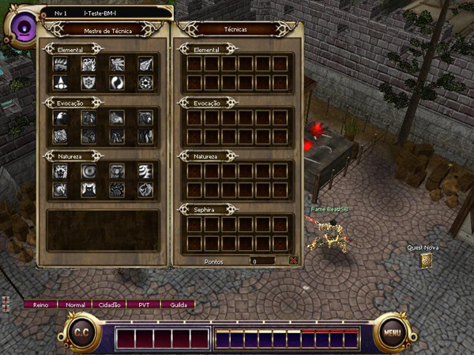
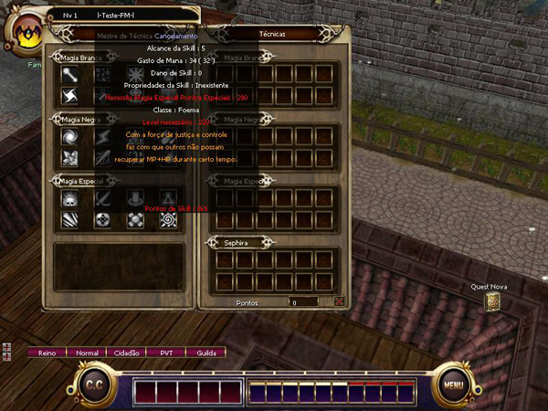
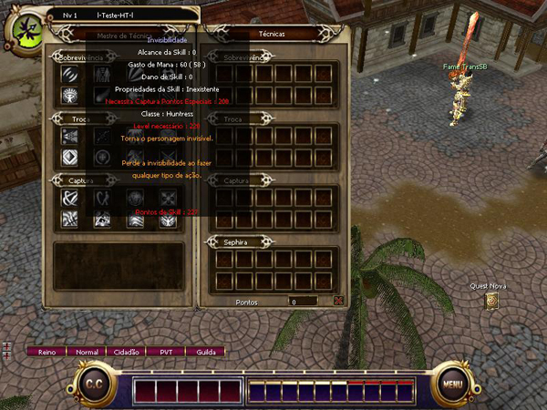
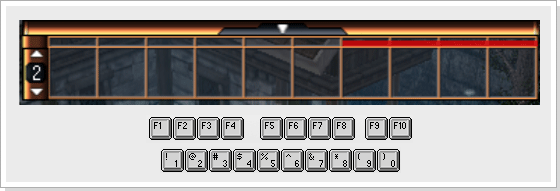

# Skills

> **Skills.** Explains how to learn skills from each class's skill master in Armia: Capitão Cavaleiros for TransKnight, Mestre Archi for Beastmaster, Foema Anciã for Foema and ForeLearne for Huntress. It describes the three skill lineages per class, the 24-skill limit, learning points, Aprender Arma and how to use the skill hotbar.

Ao evoluir a personagem através da caça, o mesmo recebe pontos de aprendizagem e pontos em skill. Para aprender uma nova skill, simplesmente vá a Armia e localize o Mestre de Skill de sua classe e compre a(s) skill(s) que desejar. Skills básicas ou de nível baixo podem ser aprendidas por um baixo preço de Pontos de Skill. A Skill pode ser aprendida somente através do NPC Mestre de Skill de cada classe. A quantidade de Pontos de Skill gastas variam de acordo com a Skill que desejar comprar.

**Skillmaster dos TransKnight (Capitão Cavaleiros)**

**Skillmaster dos Beastmaster (Mestre Archi)**

**Skillmaster das Foemas (Foema Anciã)**

**Skillmaster d****as Huntress (ForeLearne)**

Antes de aprender alguma Skill, você deve primeiro entender os atributos que são melhores ao seu personagem dependendo da linhagem de skill escolhida incorretamente, pode ser reiniciado com o Círculo Divino, Benção de Deus e a QUEST balanço do poder.

---

**Linhagem de Skill**

Cada classe possui três tipos de linhagem. Cada linhagem possui uma 10ª skill e cada personagem pode ter o total de 24 skills. O poder da skill pode ser aumentado acrescentando pontos de aprendizagem na linhagem utilizada. Aprender Arma também pode aumentar o dano físico do personagem.

Pontos de aprendizagem nas linhagens e em Aprender Arma, pode ser aumentado e ajustado de acordo com as necessidades e especificações do seu personagem. Desta maneira você pode alcançar um maior poder ao personagem.

**TransKnight**

**Beastmaster**

**Foema**

**Huntress**

A skill adquirida será adicionada na janela de árvore de skill da direita.

Para utilizar a skill ela deve ser adicionada à barra rápida de skills.

|  |
| --- |
| Para utilizar a skill, selecione a skill e com o botão direito do mouse clique em um slot vazio. |
| Você pode selecionar as skill na barra rápida de skills usando o atalho (1 ~ 0 , F1 ~ F10), as skills passivas não precisa ser equipadas.  |

Para utilizar as skills de ataque, selecione a skill desejada, posicione o cursor do mouse sobre o alvo desejado e clique com o botão direito. Para apagar uma skill da barra rápida, basta pressionar a tecla

e adicionar uma nova skill.

## Fontes

- [Skills](https://feedback.kersef.com/pt-br/knowledge-bases/21/articles/20366-skills), FAQ WYD Global (feedback.kersef.com). Cópia arquivada: [20366-skills.md](../../sources/feedback_kersef/data/articles/markdown/20366-skills.md)
