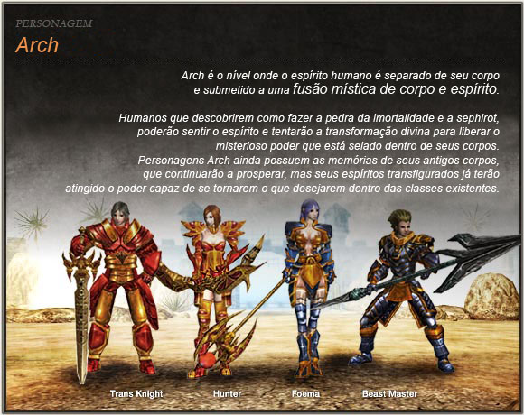

# TransKnight

> Classe guerreira de WYD, especialista em ataques físicos a curta distância, com grande quantidade de vida e eficiente tanto na caça de monstros quanto no PvP. Suas linhagens de skill são Confiança, Trans e Espada Mágica, e ela é ensinada pelo Capitão Cavaleiros em Armia.

O TransKnight é uma das quatro classes jogáveis de With Your Destiny, ao lado de [Foema](foema.md), [BeastMaster](beastmaster.md) e [Huntress](huntress.md).

**Grafia do nome:** as fontes oficiais usam várias formas. As páginas de [Skills](skills.md) e de [12ª Skills](decima-segunda-skill.md) escrevem "TransKnight"; [Personagens e Primeiras Impressões](personagens.md) e o mapa de [Armia](../mapas/armia.md) escrevem "Transknight"; o [Guia para Novatos](../progressao/guia-para-novatos.md) escreve "TRANS KNIGHT" e a tabela da página [Arch](../progressao/arch.md), "Trans Knight". As páginas de skills por tier abreviam a classe como "TK", e o drop do boss Kefra se chama "Sephirot de TK".

## Identidade e estilo de luta

As duas descrições oficiais da classe:

> Transknight que utiliza os ataques físicos e tem uma grande quantidade de vida. Muito eficiente não somente na função de caçar os monstros, mas também nos PvPs.
>
> (Personagens e Primeiras Impressões)

> TRANS KNIGHT: Guerreiro. Um corajoso cavaleiro perito em ataques a curta distância que consegue bloquear bastante dano.
>
> (Guia para novatos)

Em resumo, as fontes apresentam o TransKnight como o guerreiro corpo a corpo do jogo: ataca fisicamente, de perto, e aguenta muito dano graças ao HP alto.

## Papel em grupo e PvP

- **PvP:** a página Personagens e Primeiras Impressões diz que ele é "muito eficiente" não só na caça de monstros, mas também nos PvPs.
- **Linha de frente:** o Guia para novatos o descreve como perito em curta distância e capaz de "bloquear bastante dano".
- **Sobrevivência:** várias skills da linhagem Confiança giram em torno de invulnerabilidade e cura própria (Proteção Divina, Benção Divina e Aura de Cura; veja abaixo).

As fontes não descrevem uma função de grupo específica do TransKnight além disso.

## Atributos e builds

As fontes não trazem uma build oficial para o TransKnight, mas dão estas pistas:

- **HP alto por nível:** na tabela de evolução da página [Arch](../progressao/arch.md), o Trans Knight ganha **4 de HP** e **1 de MP** por level, o maior ganho de HP entre as quatro classes.
- **Dano físico:** o guia do [Campo de Treinamento](../quests/campo-de-treinamento.md) recomenda que classes de dano físico comprem do NPC Unicorn armas que dão Aumento de Dano. Segundo Personagens e Primeiras Impressões, o TransKnight usa ataques físicos.
- **Duas armas de uma mão:** a 9ª skill Mãos Sangrentas (Trans) só funciona "ao usar duas armas de uma mão".
- **Crítico:** a linhagem Trans aumenta o crítico (Mestre das Armas, 10ª) e o dano crítico (Fencing Master Book, 11ª).
- **INT na linhagem Confiança:** a 9ª skill Proteção Divina amplifica a cura da skill "Aura de Cura" em "10% dos pontos em INT".
- **Gelo e magia na Espada Mágica:** essa linhagem tem skills de ataque mágico e de congelamento (Espelho Mágico, Conexão de Gelo, Freezing Counter Book, Seal Master).

A página [Skills](skills.md) lembra que, se os pontos forem distribuídos de forma errada, eles podem ser reiniciados com o Círculo Divino, a Benção de Deus e a quest Balanço do Poder.

## Mestre de skill e linhagens

As skills do TransKnight são aprendidas com o **Capitão Cavaleiros** em Armia (no mapa de [Armia](../mapas/armia.md), "Cap. Cavaleiros", NPC nº 7). No mesmo mapa, o **Ferreiro** (nº 8) vende itens de defesa para Transknight e Foema.

Como toda classe, o TransKnight tem três linhagens de skill: **Confiança**, **Trans** e **Espada Mágica**. Também existe a aba **Sephira**, comum a todas as classes.

## Skills por tier

A base de conhecimento ainda não tem uma página com as skills até a 8ª. Algumas skills de tiers anteriores aparecem nas descrições das skills mais altas: Aura de Cura, Giro da Fúria, Destino (Confiança), Assalto (Trans), Lâmina Congelada e Tempestade de Gelo (Espada Mágica). A [10ª Skill](decima-skill.md) diz que Tempestade de Gelo é a **8ª skill** da linhagem Espada Mágica.

### Confiança

| Tier | Skill | Efeito (segundo a fonte) |
| --- | --- | --- |
| 9ª | Proteção Divina (Buff) | O personagem fica invulnerável por certo período, e a cura da skill "Aura de Cura" é amplificada (10% dos pontos em INT). |
| 10ª | Benção Divina (Passiva) | O HP é regenerado em 100% ao usar a 9ª skill "Proteção Divina". |
| 11ª | Blaze Launcher | Reduz uma certa quantidade de armadura do alvo ao acertar a skill "Giro da Fúria". |
| 12ª | Clod Attack (Passiva) | Ao acertar a skill Destino, há uma probabilidade de reduzir a evasão do oponente em 10% por 64 segundos. |

### Trans

| Tier | Skill | Efeito (segundo a fonte) |
| --- | --- | --- |
| 9ª | Mãos Sangrentas (Passiva) | Ao usar duas armas de uma mão e acertar um crítico, há chance de regenerar uma pequena quantidade de HP. |
| 10ª | Mestre das Armas (Passiva) | Aumenta o crítico do personagem. |
| 11ª | Fencing Master Book | Aumenta o dano crítico do personagem. |
| 12ª | WindStorm (Passiva) | Elimina a penalidade de redução de HP e maximiza o ataque ao buffar a skill Assalto. |

### Espada Mágica

| Tier | Skill | Efeito (segundo a fonte) |
| --- | --- | --- |
| 8ª | Tempestade de Gelo | Citada na 10ª e na 12ª skill; sem descrição própria nas fontes. |
| 9ª | Espelho Mágico (Passiva) | Aumenta a chance de acertar um ataque mágico no oponente. |
| 10ª | Conexão de Gelo (Passiva) | Ao usar Tempestade de Gelo, há probabilidade de congelar o oponente, impedindo-o de se mover por certo tempo. |
| 11ª | Freezing Counter Book | Aumenta em 5% o dano da skill "Lâmina Congelada". |
| 12ª | Seal Master (Passiva) | Aprimora a lentidão após congelar o inimigo com a skill Tempestade de Gelo. |

Requisitos de cada tier, conforme as páginas de skills:

- **9ª:** livro do NPC 9thMaster em Armia; level 201 ou mais, só para Celestial ou Sub-Celestial; 255 pontos de skill; só da mesma linhagem da 8ª ([Nona Skill](nona-skill.md)).
- **10ª:** todas as skills anteriores e 4000 pontos de fama ([10ª Skill](decima-skill.md)).
- **11ª:** level 281 ou mais, 8.000 de fama e o livro da skill ([11ª Skills](decima-primeira-skill.md)).
- **12ª:** Celestial acima do level 320, a 11ª da mesma linhagem e 12.000 de fama, no NPC Jazeg em Armia ([12ª Skills](decima-segunda-skill.md)).

## Evolução

- **Mortal:** como todas as classes, o TransKnight começa em Armia e faz o [Campo de Treinamento](../quests/campo-de-treinamento.md), onde o NPC Unicorn entrega uma arma inicial.
- **Arch:** o personagem Arch se parece com o da classe inicial, e o jogador pode escolher uma das quatro classes Arch. Na imagem da página [Arch](../progressao/arch.md), o "Trans Knight" aparece em sua forma Arch, à esquerda. Por level, o Arch do Trans Knight ganha 4 de HP e 1 de MP.
- **Celestial:** a criação exige, entre outros itens, a Saphirot da classe atual ([Criação do Celestial](../progressao/criacao-do-celestial.md)).
- **Sub-Celestial:** a criação exige a Sephirot da classe desejada ([Sub Celestial](../progressao/sub-celestial.md)). A 9ª skill é liberada para Celestial e Sub-Celestial, e a 12ª só para Celestial.

## Mudança de classe e de corpo

Segundo [Mudança de Classe e Mudança de Corpo](mudanca-de-classe.md):

- **Virar TransKnight:** equipe a Sephirot de TransKnight e fale com o NPC Wooreunammu em Kefra (X:3230 Y:1683), pagando 100kk, ou ative o item Sephiroth Blessing. Ao mudar de classe, todas as skills Sephira são desaprendidas.
- **Mudança de corpo:** equipe a Sephiroth da classe desejada e ative o item Sephiroth Protection, sem nenhum equipamento no personagem.
- **Onde conseguir a Sephirot:** o boss Kefra dropa a "Sephirot de TK" com 100% de chance para quem dá o último ataque ([Dungeon Kefra](../mapas/dungeon-kefra.md)).

## Veja também

- [Foema](foema.md)
- [BeastMaster](beastmaster.md)
- [Huntress](huntress.md)
- [Personagens e Primeiras Impressões](personagens.md)
- [Skills](skills.md)
- [Nona Skill (9th)](nona-skill.md)
- [10ª Skill](decima-skill.md)
- [11ª Skills](decima-primeira-skill.md)
- [12ª Skills](decima-segunda-skill.md)
- [Mudança de Classe e Mudança de Corpo](mudanca-de-classe.md)
- [Ataque Crítico x4](../sistemas/critico-x4.md)
- [Arch](../progressao/arch.md)

## Fontes

- [PERSONAGENS E PRIMEIRAS IMPRESSÕES](https://feedback.kersef.com/pt-br/knowledge-bases/21/articles/20475-personagens-e-primeiras-impressoes), FAQ WYD Global (feedback.kersef.com). Cópia arquivada: [20475-personagens-e-primeiras-impressoes.md](../../sources/feedback_kersef/data/articles/markdown/20475-personagens-e-primeiras-impressoes.md)
- [Guia para novatos](https://feedback.kersef.com/pt-br/knowledge-bases/21/articles/58185-guia-para-novatos), FAQ WYD Global (feedback.kersef.com). Cópia arquivada: [58185-guia-para-novatos.md](../../sources/feedback_kersef/data/articles/markdown/58185-guia-para-novatos.md)
- [Skills](https://feedback.kersef.com/pt-br/knowledge-bases/21/articles/20366-skills), FAQ WYD Global (feedback.kersef.com). Cópia arquivada: [20366-skills.md](../../sources/feedback_kersef/data/articles/markdown/20366-skills.md)
- [(MAPA) ARMIA](https://feedback.kersef.com/pt-br/knowledge-bases/21/articles/20375-mapa-armia), FAQ WYD Global (feedback.kersef.com). Cópia arquivada: [20375-mapa-armia.md](../../sources/feedback_kersef/data/articles/markdown/20375-mapa-armia.md)
- [Nona Skill - (9th)](https://feedback.kersef.com/pt-br/knowledge-bases/21/articles/67187-nona-skill-9th), FAQ WYD Global (feedback.kersef.com). Cópia arquivada: [67187-nona-skill-9th.md](../../sources/feedback_kersef/data/articles/markdown/67187-nona-skill-9th.md)
- [10th Skill](https://feedback.kersef.com/pt-br/knowledge-bases/21/articles/26951-10th-skill), FAQ WYD Global (feedback.kersef.com). Cópia arquivada: [26951-10th-skill.md](../../sources/feedback_kersef/data/articles/markdown/26951-10th-skill.md)
- [11º Skills](https://feedback.kersef.com/pt-br/knowledge-bases/21/articles/46455-11o-skills), FAQ WYD Global (feedback.kersef.com). Cópia arquivada: [46455-11o-skills.md](../../sources/feedback_kersef/data/articles/markdown/46455-11o-skills.md)
- [12th skills](https://feedback.kersef.com/pt-br/knowledge-bases/21/articles/50022-12th-skills), FAQ WYD Global (feedback.kersef.com). Cópia arquivada: [50022-12th-skills.md](../../sources/feedback_kersef/data/articles/markdown/50022-12th-skills.md)
- [Arch](https://feedback.kersef.com/pt-br/knowledge-bases/21/articles/20384-arch), FAQ WYD Global (feedback.kersef.com). Cópia arquivada: [20384-arch.md](../../sources/feedback_kersef/data/articles/markdown/20384-arch.md)
- [Criação do Celestial](https://feedback.kersef.com/pt-br/knowledge-bases/21/articles/22279-criacao-do-celestial), FAQ WYD Global (feedback.kersef.com). Cópia arquivada: [22279-criacao-do-celestial.md](../../sources/feedback_kersef/data/articles/markdown/22279-criacao-do-celestial.md)
- [Criação de sub-celestial](https://feedback.kersef.com/pt-br/knowledge-bases/21/articles/22808-criacao-de-sub-celestial), FAQ WYD Global (feedback.kersef.com). Cópia arquivada: [22808-criacao-de-sub-celestial.md](../../sources/feedback_kersef/data/articles/markdown/22808-criacao-de-sub-celestial.md)
- [GUIA: Mudança de classe e mudança de corpo](https://feedback.kersef.com/pt-br/knowledge-bases/21/articles/23390-guia-mudanca-de-classe-e-mudanca-de-corpo), FAQ WYD Global (feedback.kersef.com). Cópia arquivada: [23390-guia-mudanca-de-classe-e-mudanca-de-corpo.md](../../sources/feedback_kersef/data/articles/markdown/23390-guia-mudanca-de-classe-e-mudanca-de-corpo.md)
- [Dungeon Kefra](https://feedback.kersef.com/pt-br/knowledge-bases/21/articles/21703-dungeon-kefra), FAQ WYD Global (feedback.kersef.com). Cópia arquivada: [21703-dungeon-kefra.md](../../sources/feedback_kersef/data/articles/markdown/21703-dungeon-kefra.md)
- [Campo de Treino](https://wydglobal.raidhut.com/#training-camp), Guia Quest Mortal (Raid Hut). Cópia arquivada: [quests_mortais.md](../../sources/raidhut_quests/data/articles/markdown/quests_mortais.md)
