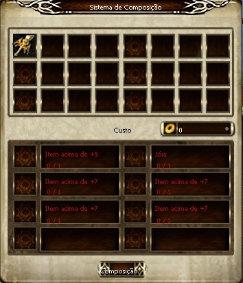
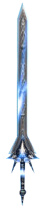
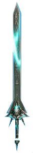
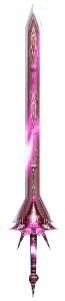
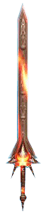

# Armas Ancient

> **Ancient Weapons.** Explains how to combine a +9 weapon with a Diamond, Emerald, Coral or Garnet gem at the Compositor NPC in Azran to create an Ancient weapon with an extra attribute. Optional +7 to +10 items raise the success chance, and all items are lost on failure.

Uma arma refinada até +9 ainda pode ser aprimorada através de uma combinação com jóias especiais. Um aprimoramento bem sucedido de uma arma Ancient proporciona, além da força de ataque maior, um atributo extra, dependendo do tipo de jóia utilizada. Para proceder com esse aprimoramento, é necessário uma das seguintes jóias: Diamante, Esmeralda, Coral ou Garnet. Também é possível utilizar outros itens já aprimorados para aumentar a chance de sucesso da refinação.

**Combinação de itens**

Você pode combinar sua arma Ancient através do NPC Compositor, localizado na cidade de Azran. Serão necessários: uma arma +9, uma jóia (Diamante, Esmeralda, Coral ou Garnet) e, se desejar, quaisquer outros itens já refinados, que aumentam a chance de sucesso da combinação.

**Observação:**

Se a combinação falhar, todos os itens irão desaparecer. Esse procedimento pode ser executado somente uma vez. Tentar combinar itens Ancient novamente não terá efeito. Além disso, itens +11 não podem ser usados para aumentar as chances da combinação.

| tem | Qde. | Descrição |
| --- | --- | --- |
|  | Arma para combinar | 1 | Apenas armas +9 podem ser utilizadas. |
| Jóia | 1 | Jóia necessária para que a combinação seja realizada. São elas: Diamante, Esmeralda, Coral ou Garnet. |
| Outros Itens | 0~4 | Esses itens são opcionais, mas são utilizados para aumentar a porcentagem de sucesso da combinação. Qualquer tipo de item pode ser utilizado, desde que possua uma refinação de +7 ou maior.   Item +7 : +2% prob. de sucesso  Item +8 :+ 4% prob. de sucesso  Item +9 : +10% prob. de sucesso  Item +10 : +12% prob. de sucesso   Exemplo : Ao utilizar quatro itens +9 na combinação, a probabilidade de sucesso aumenta em 40%. |

**Observação sobre o uso de outros itens**

Quando forem usados outros itens para aumentar a chance de sucesso da combinação, não se esqueça que são necessários itens de refinação +7~+10, e que é necessário que possuam no máximo uma classe inferior ao item a ser combinado. Exemplo: Se a arma a ser combinada possui a classe D, os itens usados para aumentar as chances de sucesso devem ser obrigatoriamente C, ou maior. **Combinação**
Após a combinação, a arma Ancient irá possuir a refinação de +7. O item mantém o atributo referente à jóia utilizada no processo, mas é possível a alteração desse atributo através do uso de outra jóia.

|  |  |  |  |  |
| --- | --- | --- | --- | --- |
| Item |  |  |  |  |
| Jóia |  |  |  |  |
| Atributo | Aumenta em 8% a taxa de drop | Adiciona 80 pontos de Perfuração | Aumenta em 2% a experiência obtida | Adiciona 80 pontos de Absorção |

## Fontes

- [Armas Ancient](https://feedback.kersef.com/pt-br/knowledge-bases/21/articles/20390-armas-ancient), FAQ WYD Global (feedback.kersef.com). Cópia arquivada: [20390-armas-ancient.md](../../sources/feedback_kersef/data/articles/markdown/20390-armas-ancient.md)
