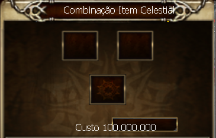

# Passando Adicional para Arma Arch

> **Transferring Additional Stats to an Arch Weapon.** Short guide to transferring an additional (add) to an Arch weapon at the NPC Tainy in Karden, using the target +9 Ancient weapon, a +9 Ancient weapon with the desired add, a +9 [D] or [E] item and 100,000,000 gold. The process can fail.

Nenhuma arma é boa o suficiente se não tiver um add considerável em sua base, para isso existe uma forma de deixá-la forte o suficiente.

Para realizar tal feito é necessário ter os seguintes itens:

* Arma desejada +9 (anct)
* Arma com o add +9 (anct)
* item [D] ou [E] +9
* 100.000.000 de gold

 

Vá ao NPC Tainy em Karden (gelo) e entregue os itens, mas lembre-se: a chance de falha não pode ser descartada.

Boa sorte!

## Fontes

- [Passando adicional para arma Arch](https://feedback.kersef.com/pt-br/knowledge-bases/21/articles/22809-passando-adicional-para-arma-arch), FAQ WYD Global (feedback.kersef.com). Cópia arquivada: [22809-passando-adicional-para-arma-arch.md](../../sources/feedback_kersef/data/articles/markdown/22809-passando-adicional-para-arma-arch.md)
