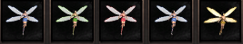
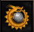

# Fadas

> **Fairies.** Guide to the five fairies (blue, green, red, silver and golden), support items that boost drop rate and experience. Blue, green and red are sold by Premium Neil, while silver and golden are made from a red fairy with the Silver Flash from Farche in Erion or the Golden Flash from Mai, and they auto-sell non-stackable drops.

As fadas são itens de apoio aos personagens e tem como objetivo melhorar e facilitar os itens dropados a partir dos MOBs. Atualmente existem 5 fadas no servidor, são elas:

Fada azul, verde, vermelha, prateada e dourada.

**Fada azul**

Pode ser encontrada através da loja do jogo (Prisang Nell) ou negociada por jogadores no servidor. Possui 3 dias de duração após ser equipada e custa 80 NPs. Essa fada aumenta a porcentagem de drop em 32%.

**Fada verde**

Encontrada na Prisang Nell por 120 NPs ou através de negociações entre jogadores. Essa fada aumenta a experiência do personagem em 16%. Possui 3 dias de duração após ser equipada.

**Fada vermelha**

Ela custa 200 Nps na Prisang Nell, mas também pode ser negociada entre jogadores no servidor. Ela aumenta em 16% a experiência do personagem e 32% de chance de drop. Possui 3 dias de duração após ser equipada.

**Fada prateada**

Para obtê-la, é preciso possuir a fada vermelha e o item “Flash prateado”, encontrado no NPC Farche em Erion pelo valor de 2kk em gold.

Basta equipar a fada vermelha e utilizar o flash para transformá-la em prateada. Essa fada possui os mesmos atributos da fada vermelha (32% drop/ 16% XP), porém, vende automaticamente os itens não agrupáveis, dropados por MOBs ao serem abatidos. Essa fada também agrupa automaticamente os itens agrupáveis em seu inventário.

**Fada Dourada**

Para criar essa fada, é preciso ir até Niflheim (cidade do gelo) e comprar o item “Flash dourado” no NPC Mai por 12kk em gold. Equipe a fada, utilize o flash e você irá obter a fada dourada. Essa fada aumenta em 18% a taxa de experiência e 50% de drop e possui a mesma funcionalidade da fada vermelha.

**Obs: As fadas douradas e prateadas excluem todos os itens não agrupáveis com exceção das Pedras da Luz.**

## Fontes

- [GUIA: Fadas](https://feedback.kersef.com/pt-br/knowledge-bases/21/articles/58182-guia-fadas), FAQ WYD Global (feedback.kersef.com). Cópia arquivada: [58182-guia-fadas.md](../../sources/feedback_kersef/data/articles/markdown/58182-guia-fadas.md)
