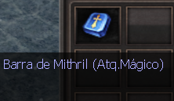

# Barra de Mithril

> **Mithril Bar.** Guide to Mithril Bars, which improve the additional stats of Arch and celestial weapons and armor refined to at least +11, in Magic Attack, Damage, Critical, Defense and Immunity classes. It lists the maximum add per class and equipment slot and the threshold below which bars no longer reduce the add.

As barras de mithril são itens utilizados para aprimorar o adicional de armaduras e armas de classes Archs ou Celestiais.

Embora o ícone dos itens pareçam iguais, existem várias classes de barras, então preste atenção na descrição.

As classes são: **Ataque mágico, Dano, Crítico, Defesa e Imunidade.**

**As armaduras e armas precisam estar com a refinação mínima em +11 para o processo ser iniciado.**

**ADICIONAL MÁXIMO DE CADA CLASSE:**

**ATAQUE MÁGICO**:

* Armaduras - 20% máximo
* Armas - 44% máximo

**DANO:**

* Peito e calça - 54 máximo
* Bota - 84 máximo
* Luva - 66 máximo
* Armas - 99 máximo

**CRÍTICO:**

* Peito e calça - 13% máximo

**DEFESA:**

* Peito e calça - 60 máximo
* Luva - 90 máximo

**IMUNIDADES:**

* Luva - 42 máximo

**Agora a chance de reduzir o adicional de um item ao utilizar o item “Barra de mithril” será desligada quando o adicional do item atingir um valor mínimo. Dessa forma, a barra ainda poderá ser utilizada, mas não haverá chance do adicional ser reduzido. Confira em qual ponto a "Proteção de adicional” é ativada na lista abaixo:**

**Aumento de dano: 24
Ataque mágico: 8%
Chance de Crítico: 6%
Defesa: 25** **O caminho para obter os aprimoramentos máximos não é fácil. As barras podem falhar, não sofrer alterações ou refinar, então:**

BOA SORTE E NÃO DESISTA!

## Fontes

- [GUIA: Barra de Mithril](https://feedback.kersef.com/pt-br/knowledge-bases/21/articles/24025-guia-barra-de-mithril), FAQ WYD Global (feedback.kersef.com). Cópia arquivada: [24025-guia-barra-de-mithril.md](../../sources/feedback_kersef/data/articles/markdown/24025-guia-barra-de-mithril.md)
