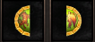

# Fragmentos da Alma

> **Soul Fragments.** Soul Fragments are traded in sets of 12 to the NPC Alchemy Annie in Azran for a random Phoenix or Unicorn Soul, used to make the Stone of Immortality for Arch, Celestial and Sub Celestial characters. They drop from RujeperBroken in the desert, LichVatama and LichCrunt in Kefra, and the Unknown Desert.

Os Fragmentos da alma são itens utilizados para compor as Almas da Fênix e do Unicórnio, responsáveis pela criação da pedra da imortalidade (itens importantes para a evolução dos personagens Arch, Celestial e Sub Celestial).

Leve 12 unidades do fragmento da alma até o NPC Alchemy Annie localizado em Azram (X: 2511 Y:1729).

Após realizar esse procedimento, o NPC lhe entregará aleatoriamente uma das 2 almas: Unicórnio ou Fenix.

Os fragmentos da Alma podem ser encontrados no:

* Deserto: MOB RujeperBroken
* Kefra: MOBS LichVatama e LichCrunt
* Quest Deserto desconhecido

-> A taxa de drop desses itens são bem baixas, então boa sorte em sua caçada!

## Fontes

- [GUIA: Fragmentos da Alma](https://feedback.kersef.com/pt-br/knowledge-bases/21/articles/58184-guia-fragmentos-da-alma), FAQ WYD Global (feedback.kersef.com). Cópia arquivada: [58184-guia-fragmentos-da-alma.md](../../sources/feedback_kersef/data/articles/markdown/58184-guia-fragmentos-da-alma.md)
