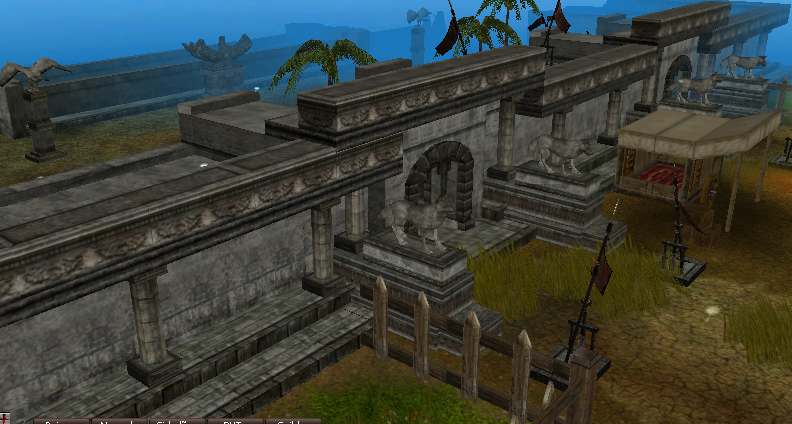
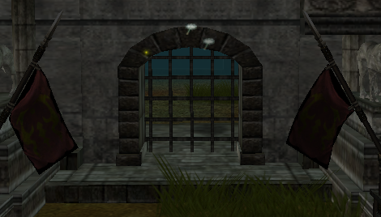
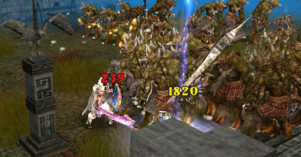

# Coliseu

> Quest diária de drop com PvP na arena a leste de Azran, nos servidores novatos, com entrada pelo item Notificação Pública. Acontece em três níveis às 19:00, 20:00 e 21:00, os dois primeiros apenas para Mortais e Archs, e dropa cristais, restos e poeiras de Ori e Lac.

O coliseu é uma quest de drop que ocorre diariamente, nos servidores novatos. A grande arena está localizada no Leste de Azran, na coordenada: (X:2596 Y:1726).

**COMO PARTICIPAR:**

Entre na arena no horário em que o seu personagem se enquadra e aguarde os portões serem fechados.

**O QUE FAZER:**

Após o início da quest, monstros com grande capacidade de drop surgirão.

Obs: Vá preparado, pois a quest é PVP!

****

**HORÁRIOS:**

Nível 1.

19:00 - Apenas personagens Mortais e Archs podem participar.

19:05 - Entradas e saídas serão seladas.

19:07 - A divisória será aberta e os monstros aparecerão.

19:17 - Fim da Quest.

Nível 2.

20:00 - Apenas personagens Mortais e Arch podem participar.

20:05 - Entradas e saídas serão seladas.

20:07 - A divisória será aberta e os monstros aparecerão.

20:17 - Fim da Quest.

Nível 3.

21:00 - Todos os personagens podem participar.

21:05 - Entradas e saídas serão seladas.

21:07 - A divisória será aberta e os monstros aparecerão.

21:17 - Fim da Quest.

**OBS: Será necessário o item Notificação Pública para participar da Quest. As quests ocorrem no servidor novato.**

**DROPS:**

O Drop das as salas se resumem a cristais, restos e poeiras de Ori e Lac. A capacidade de drop da quest está relacionada aos níveis. Quanto maior o Nível, mais itens o jogador irá adquirir.

## Fontes

- [Coliseu](https://feedback.kersef.com/pt-br/knowledge-bases/21/articles/22855-coliseu), FAQ WYD Global (feedback.kersef.com). Cópia arquivada: [22855-coliseu.md](../../sources/feedback_kersef/data/articles/markdown/22855-coliseu.md)
