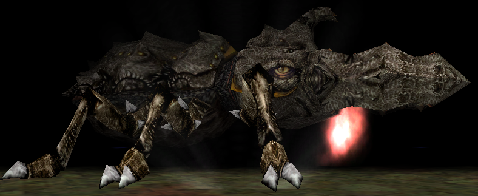
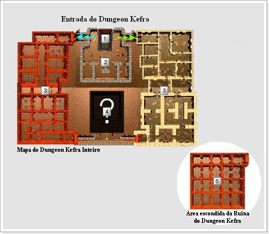
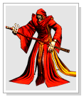

# Dungeon Kefra

> **Kefra Dungeon.** Covers the Kefra Dungeon map, its lore about the struggle over the Crown of Athila and the Kult Desert, and the weekly Kefra boss fight in the Kefra Hall, reached by giving a Sealed Scroll to the Survivor NPC. Defeating Kefra opens a portal on the beginner channel to the Unknown Continent, home of Alquimista Odin and Uxmal; drops include the Stone of Immortality and Sephirots.

## (MAPA) Dungeon kefra (FAQ WYD Global)

| Num. | Nome | Descrição |
| --- | --- | --- |
| 1 - | Entrada | - PvP não permitido.  - Teleporte/Convocação permitida entre membros de Grupo/Gruilda.  - Marco de posição através da Gema Estelar/Pergaminho do Retorno permitido.  - Existência do NPC comerciante Teron.  - Dentro do campo nomes do personagem, nome da guilda não aparecem.  - Impossível utilizar o chat normal (Apenas chat em guilda/grupo/mensagem privada permitido) |
| 2 - | Zona de Caça | - Monstros irão aparecer nessa área.  - Nomes dos personagens e guildas não aparecem.  - Impossível utilizar o chat normal (Apenas chat em guilda/grupo/mensagem privada permitido)  - Dano causado não a monstros e outros jogadores não irão aparecer.  - Não existe aumento de experiência no caso de praticar PK, mas existe uma Redução de experiência no caso de ter sido morto por outro jogador. |
| 3 - | Zona de Caça | - Monstros irão aparecer nessa área.  - Nomes dos personagens e guildas não aparecem.  - Impossível utilizar o chat normal (Apenas chat em guilda/grupo/mensagem privada permitido)  - Dano causado não a monstros e outros jogadores não irão aparecer.  - Não existe aumento de experiência no caso de praticar PK, mas existe uma Redução de experiência no caso de ter sido morto por outro jogador.  - Monstros são mais fortes nessa área comparado a monstros da área anterior. |
| 4 - | ? | ? |
| 5 - | Área escondida da ruina do Dungeon Kefra | Após completar as QUESTs necessárias, os jogadores poderão acessar a Área escondida do Dungeon Kefra. |

A violenta disputa pela de 'Coroa de Athila' entre os reinos de Hekalotia e Akelonia.

Para ter a certeza da vitória, os povos precisavam, a todo custo, de informações sobre a nova área descoberta, chamada Deserto de Kult.

Os dois reinos concentraram-se totalmente em coletar as informações do deserto, formando, numa especie de competição, um grande grupo de exploradores composto pelos cavaleiros de elite. A ambição dos humanos era imensa. Através da coragem dos exploradores e de investigações detalhadas, o Deserto de Kult, que parecia insondável, começou lentamente a mostrar sua forma.

Todos os tipos de informação foram reportados, como características do terreno, sua extensão e as criaturas existentes. Quando os Magos veteranos do reino decidiram que não haveria mais informações novas sobre o Deserto de Kult, um grupo de exploradores do reino de Akelonia descobriu uma enorme construção no fim do Deserto. De tamanho colossal, era difícil acreditar que tudo aquilo havia sido construído sobre pura areia: era o Dungeon Kefra.

## Dungeon Kefra (FAQ WYD Global)

##### **Dungeon Kefra**

O mapa da dungeon Kefra, esconde um colosso de mesmo nome em uma de suas salas: o mortal Kefra. O poderoso Boss guarda um portal para o **Continente Desconhecido**.(local onde se realiza a *quest* "**Pista das Runas**")

A fim de chegar ao **Continente Desconhecido**, onde estão localizados os NPCs **Alquimista Odin** e **Uxmal**, você deverá ir ao mapa para derrotar o Kefra no seu servidor, ir até a Dungeon Kefra, passando pelo território do Lich Crunt (2202 3866) até chegar a entrada do **Hall do Kefra -** localizado no número "4" do mapa abaixo. (2365 3892).

Para acessar o Hall do Kefra, é preciso entregar um Pergaminho Selado ao NPC Sobrevivente (2371 3887). Para cada pergaminho selado, o NPC lhe concederá 100 entradas para o **Hall do Kefra (4).**

**OBS1:** Todos os canais podem tentar matar o Kefra, mas o portal só será aberto no **canal novato (Servidor verde).**

**OBS2:**Para sair do Continente Perdido tente utilizar o Pergaminho de Retorno ou relogue seu personagem. Não existe restrição de level ou classe para acessar o Continente Desconhecido.

Na cidade desconhecida de Kefra você encontrará NPC que vendem itens e npcs para composições de itens ,dentre estes estão os NPCs necessários para compor itens +12 a +15.

**COMO DERROTAR O KEFRA?**

O Boss Kefra aparece uma vez por semana em todos os canais. Ao entrar no Hall do Kefra (atravessando o portal), você encontrará o boss Kefra, alguns Lichs e um numero alto de mini-bosses que auxiliam o grande Kefra em batalha.

O nível de dificuldade da *quest* é bem elevado, já que o boss tem grande quantidade de HP, dano e algumas skills próprias bastante poderosas. Logo, é necessário formar um grande **grupo**para derrotar esse monstro. É recomendo a união entre guildas e jogadores para formar uma caçada épica. Ao derrotar o Boss os jogadores receberão premiações valiosas.

**DROP:**

O jogador que abate a criatura (ultimo ataque). Recebe automaticamente em seu inventário os itens:

Pedra da imortalidade (100% de chance).

Sephirot de TK (100% de chance).

Sephirot de FM (100% de chance).

Sephirot de BM (100% de chance).

Sephirot de HT (100% de chance).

Poeira de Lac 100% (100% de chance).

Skill Sephira: Força Espectral (100% de chance).

Alma do Beriel (50% de chance).

Pedra Lunar (50% de chance).

Joia da escuridão (25% de chance)

Ovo de Hipogrifo (2% de chance).

**LEMBRE-SE: É necessário permancer com espaço no inventário para que os itens possam ser entregues.**

## Fontes

- [(MAPA) Dungeon kefra](https://feedback.kersef.com/pt-br/knowledge-bases/21/articles/20378-mapa-dungeon-kefra), FAQ WYD Global (feedback.kersef.com). Cópia arquivada: [20378-mapa-dungeon-kefra.md](../../sources/feedback_kersef/data/articles/markdown/20378-mapa-dungeon-kefra.md)
- [Dungeon Kefra](https://feedback.kersef.com/pt-br/knowledge-bases/21/articles/21703-dungeon-kefra), FAQ WYD Global (feedback.kersef.com). Cópia arquivada: [21703-dungeon-kefra.md](../../sources/feedback_kersef/data/articles/markdown/21703-dungeon-kefra.md)
