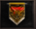

# Pesadelo A

> **Nightmare A.** Group leveling quest for high-level Arch and celestial characters, set in Azran, where the party protects 8 city NPCs for 15 minutes. Entry is possible at XX:10, XX:30 and XX:50, and the enemies include Taron, Iron Taron, Hell Spider, Manticora and Lugefer.

O pesadelo (A) é a é a melhor forma para upar personagens archs de níveis mais elevados ou celestiais. Essa quest se passa em Azran e o objetivo é proteger os NPCs da cidade. Existem 8 NPCs em azran que precisam de atenção, e garantir que nada aconteça com eles é muito importante, pois a xp do pesadelo reduz a cada NPC morto.

**ATENÇÃO: Esse item precisa ser utilizado em grupo!**

****

**O USO**

O item de entrada para o pesadelo pode ser utilizada nas horas:

XX:10

XX:30

XX:50

Ou seja, 3 vezes por hora. Prestem atenção para não perder a entrada!

Outro fato importante, após a entrada, a equipe tem 4 minutos para pensar na melhor tática possível. A ideia se distribuírem e se posicionarem bem para garantir que os NPCs percam o mínimo de HP possivel.

INFORMAÇÕES IMPORTANTES:

* O Item “Pesadelo” é consumido independente do sucesso ou do fração da quest
* É Permitido apenas, o teleporte para a cidade utilizando o pergaminho do retorno durante o procedimento da quest.

**OS MOBS**

Nessa quest, alguns mobs vão aparecer repentinamente:

* Taron
* Iron Taron
* Hell Spider
* Manticora

As Manticoras, são os MOBs mais fortes dessa quest, então evitem certa aproximação em um grupo grande, pode causar uma morte imediata!

Se em um determinado tempo do Pesadelo, os 8 NPCs não forem abatidos, um novo mob aparecerá para dificultar a missão: Lugefer.

Ao morrer, os Lugefers dropam itens com 100% de chance, porém não são tão fáceis de serem abatidos e o seu dano precisa ser levado em consideração!

**A quest dura 15 minutos, boa sorte!**

## Fontes

- [Pesadelo A](https://feedback.kersef.com/pt-br/knowledge-bases/21/articles/22544-pesadelo-a), FAQ WYD Global (feedback.kersef.com). Cópia arquivada: [22544-pesadelo-a.md](../../sources/feedback_kersef/data/articles/markdown/22544-pesadelo-a.md)
