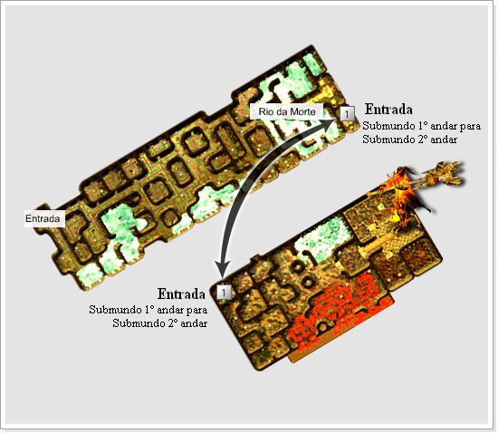

# Submundo

> **Underworld.** Lore of the Underworld, born from the war between the kingdoms of Hekalotia and Akelonia over the celestial ore 'Temuh'. The area is split into the Nikirr Dungeon (first level) and the Underworld (second level) beyond the River of Death, with demon-type monsters growing stronger deeper in.

Na época em que o processo de mineração estava no auge, dois reinos do continente de Kerserf, Hekalotia e Akelonia, disputavam entre si os melhores minérios e a melhor tecnologia para extrai-los do solo. Numa dessas escavações, eles encontraram em minério celestial, que foi chamado de 'Temuh'. Esse minério foi descoberto numa Dungeon nas colinas da montanha Nikirr e no mesmo lugar onde ele foi encontrado, os humanos descobriam uma passagem que os levariam para as profundezas da terra. Esse lugar recebeu o nome de Submundo.

O minério chamado 'Temuh' foi descoberto durante o processo de formação das vilas da antiga civilização dos humanos superiores depois de sua criação. Depois de muitos estudos, foi descoberto que graças a esse minério os humanos conseguiram grandes avanços na ciência e em tecnologia, pois esse era verdadeiramente um dos presentes dos deuses para a humanidade.

Os dois reinos começaram a brigar pela exclusividade no uso do 'Temuh', pois quem dominasse as propriedades do minério conseguiria prosperidade e poder para sua nação. A ganância falou mais alto e os reinos começaram uma guerra que não teria vencendor, e as marcas dessa guerra ainda podem ser vistas na caverna de Nikirr. Nessas batalhas sangrentas, esta colina começa a se revelar pouco a pouco aos humanos, finalmente abrindo um caminho que liga para o Submundo. Eles acabaram colocando um pé na entrada do mundo que e a moradia dos caidos, aqueles que possuem um odio profundo pelos deuses e humanos tão queridos por eles.

Ao chegar na entrada desse mundo, apareceram monstros com poderes inigualaveis aqueles já conhecidos da humanidade, e mesmo com a força dos reinos lutando lado a lado, nada poderia dete-los. Por isso a colina Nikirr foi interditada e ninguém pode atravessar o 'Rio da Morte', um rio que marca a fronteira entre a Dungeon Nikirr e o submundo.

A atual situação e que os dois reinos estão em sinal de alerta constante para proteger o Temuh e não deixar que os monstros assolem o mundo novamente. Para isso, foi colocado um batalhão inteiro de guardas.

Esta área popularmente chamada de 'Submundo' e dívidida em primeiro subsolo, chamado de 'Dungeon Nikirr' e o segundo subsolo de 'Underworld (Submundo)'. A entrada para Underworld está localizada no final do subsolo, além da área chamada 'Rio da Morte'.

A região da entrada do subsolo tem os monstros aparentemente fáceis de se enfrentar, mas a cada passo dado em direção ao coração do Submundo, aparecem monstros fortíssimos que não se comparam aos de qualquer outro campo. No segundo subsolo aparecem frequentemente os monstros do tipo demonio com poderes ainda maiores.

## Fontes

- [(MAPA) Submundo](https://feedback.kersef.com/pt-br/knowledge-bases/21/articles/20377-mapa-submundo), FAQ WYD Global (feedback.kersef.com). Cópia arquivada: [20377-mapa-submundo.md](../../sources/feedback_kersef/data/articles/markdown/20377-mapa-submundo.md)
