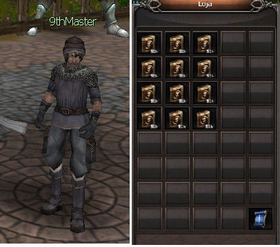

# 9th Master

> **9th Master.** The 9th Master NPC in Armia (X:2136 Y:2115) provides the ninth skill book for each class; books are account-bound and purchases cannot be undone.

Esse NPC é responsável pela entrega na nona skill da classe desejada. Ele fica localizado em Armia (X:2136 Y:2115) próximo a saída para o campo de Armia,

**ATENÇÂO:**

1. **Cada livro pertence a uma classe específica, então preste atenção na skill que está sendo adquirida para não ter problemas com a compra.**
2. **Todos os livros são imóveis, ou seja, uma vez adquiridos não podem ser transferidos para outra conta.**
3. **A equipe não se responsabiliza por compras erradas. Depois de adquiridos a ação não poderá ser desfeita.**

## Fontes

- [NPC 9th Master](https://feedback.kersef.com/pt-br/knowledge-bases/21/articles/48534-npc-9th-master), FAQ WYD Global (feedback.kersef.com). Cópia arquivada: [48534-npc-9th-master.md](../../sources/feedback_kersef/data/articles/markdown/48534-npc-9th-master.md)
