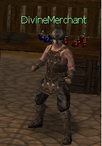
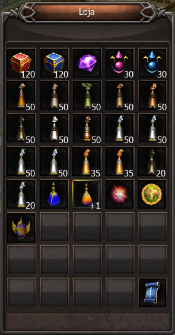

# DivineMerchant (Victory Coupom)

> O NPC DivineMerchant, em Armia (X:2143 Y:2087), vende itens vinculados à conta em troca de Victory Coupons dropados nas LAN N, M e A, incluindo a Pedra da Imortalidade para criar Arch, Amagos de montaria e a Pedra Ideal (Limitada) para criar Celestial.

O DivineMerchant é um NPC importante localizado na cidade de Armia (X:2143 Y: 2087) que ajuda na evolução dos jogadores.

Nele você encontra vários itens que podem ser adquiridos através dos Cupons encontrados nas LANs N, M e A. Esses itens são:

**IMPORTANTE!**

* **Todos os itens são Imóveis e por isso não pode ser transferido para outra conta.**
* **O item PEDRA DA IMORTALIDADE encontrado nesse NPC pode apenas ser utilizado na criação do Arch. Por ser imóvel não será útil em outras progressões ou composições no jogo com criação da PEDRA****IDEAL.**
* **Agora também será possível adquirir os âmagos das montarias Grifo, Hipogrifo, Svadilfari e Sleipnir.**
* **Agora será possível adquirir o item **“Pedra Ideal(Limitada)”** imóvel pelo preço de 50 Victory Coupons. A Pedra Ideal(Limitada) apenas pode ser utilizada para criar personagens Celestiais.**

## Fontes

- [NPC DivineMerchant (Victory Coupom)](https://feedback.kersef.com/pt-br/knowledge-bases/21/articles/48532-npc-divinemerchant-victory-coupom), FAQ WYD Global (feedback.kersef.com). Cópia arquivada: [48532-npc-divinemerchant-victory-coupom.md](../../sources/feedback_kersef/data/articles/markdown/48532-npc-divinemerchant-victory-coupom.md)
