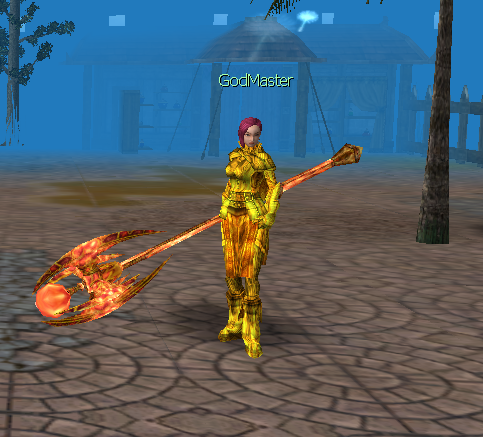
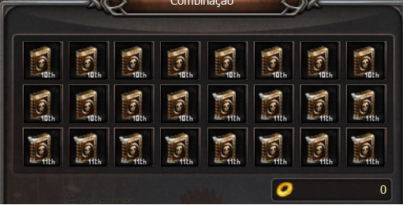
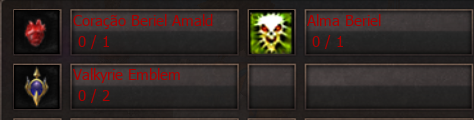
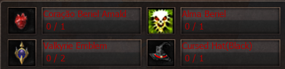

# GodMaster

> **GodMaster.** The GodMaster NPC in Armia (X:2126 Y:2123) trades class-specific skill books such as the 10th and 11th skills; books are account-bound and purchases cannot be undone.

O NPC GodMaster fica localizado na cidade de Armia (X: 2126 Y: 2123) e tem como principal objetivo principal negociar livros de skill com os jogadores interessados em aprimorar seus personagens.

Ao clicar no livro desejado, será informado os itens necessários para obtenção dos mesmos. Por exemplo:

* Para obter a 10ª Skill:

* Para obter a 11ª Skill:

****

**ATENÇÂO:**

1. **Cada livro pertence a uma classe específica, então preste atenção na skill que está sendo adquirida para não ter problemas com a compra.**
2. **Todos os livros são imóveis, ou seja, uma vez adquiridos não podem ser transferidos para outra conta.**
3. **A equipe não se responsabiliza por compras erradas. Depois de adquiridos a ação não poderá ser desfeita.**

## Fontes

- [NPC GodMaster](https://feedback.kersef.com/pt-br/knowledge-bases/21/articles/48529-npc-godmaster), FAQ WYD Global (feedback.kersef.com). Cópia arquivada: [48529-npc-godmaster.md](../../sources/feedback_kersef/data/articles/markdown/48529-npc-godmaster.md)
