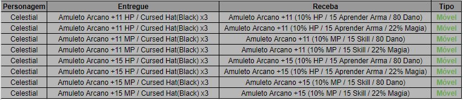

# Jazeg

> **Jazeg.** The Jazeg NPC (2117 2081) changes the bonus option on Amuleto Arcano (HP) and Amuleto Arcano (MP) items refined to +11 or +15, with no chance of failure.

Adicionado o NPC Jazeg(2117 2081) onde será possível alterar o adicional nos itens “Amuleto Arcano (HP)” e “Amuleto Arcano(MP)” que possuírem a refinação +11 ou +15.

-> Não existe chance de falha na composição.

-> Qualquer problema envolvendo o NPC informado, basta nos informar!

## Fontes

- [NPC Jazeg](https://feedback.kersef.com/pt-br/knowledge-bases/21/articles/48732-npc-jazeg), FAQ WYD Global (feedback.kersef.com). Cópia arquivada: [48732-npc-jazeg.md](../../sources/feedback_kersef/data/articles/markdown/48732-npc-jazeg.md)
