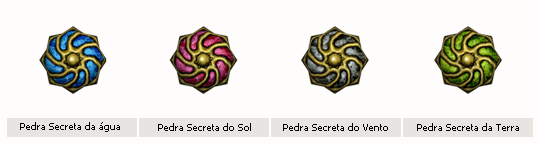
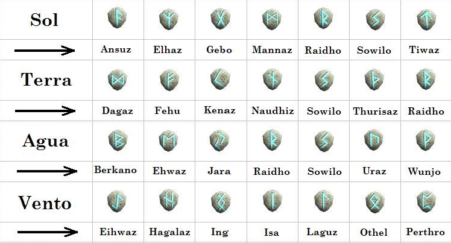

# Criação do Celestial

> Explica como criar um Celestial, o que exige um mortal nível 400, um Arch de pelo menos nível 356, as quatro pedras secretas, a Saphirot da classe e a Pedra da Imortalidade. O Odin em Kefra cuida das pedras secretas, e a Ehre em Erion configura a skill Limite da Alma (Soul) com combinações de joias.

O Celestial é o 3º personagem liberado após o começo de uma saga. Para poder criá-lo, é necessário ter um personagem mortal level 400 e um arch level 356 (mínimo permitido). É importante afirmar que quanto maior o level do arch, mais forte o celestial se torna.

ATRIBUTOS

* Mudança da capa do personagem.
* Atribuição de pontos relacionados a o level do personagem Arch
* Aprendizagem da skill sephira: Limite da alma, também conhecida como Soul
* Cythera (tiara): Pode variar em prateada, dourada e mística dependendo do level do personagem e da conclusão da quest arch: OS 4 CRISTAIS. Se o personagem atender todas as exigências (estar com o level máximo e concluir a quest) a Cythera recebida será a mística.

CRIAÇÃO DO PERSONAGEM

Para criar o personagem, são necessários os itens:

* 4 pedras secretas: Sol, Terra, Vento e Água
* Saphirot da sua classe atual
* Pedra da Imortalidade

Ao obter todos todos os itens é necessário equipar o Saphirot, a pedra da imortalidade e ter as 4 pedras secretas no inventário. É importante lembrar que a composição de pedra ideal precisa ser feita por um arch, pois caso o personagem seja um mortal o resultado será a criação de um novo arch. Após isso fale com o rei do seu reino e será criada a pedra Ideal.

PEDRAS SECRETAS

As pedras secretas são criada através da combinação de runas específicas. Após obter as pedras corretas de cada combinação é preciso procurar o NPC “Odin” na cidade de Kefra.

CONFIGURAÇÃO DA SKILL: LIMITE DA ALMA

A skill “limite da alma” atribui pontos de habilidades de acordo com sua configuração. O NPC responsável pela configuração da soul é o Ehre, em Erion. Para configurar da forma que melhore as características do personagem, é necessário fazer uma certa combinação de jóias:

FOR/CON: Diamante + Diamante + Diamante.

INT/CON: Esmeralda + Esmeralda + Esmeralda.

DES/CON: Coral + Coral + Coral.

FOR/DES: Garnet + Garnet + Garnet.

INT/DES: Diamante + Esmeralda + Coral.

CON/DES: Diamante + Coral + Garnet.

FOR: Esmeralda + Coral + Garnet.

INT: Esmeralda + Diamante + Coral.

CON: Coral + Esmeralda + Garnet.

DES: Garnet + Diamante + Coral.

## Fontes

- [Criação do Celestial](https://feedback.kersef.com/pt-br/knowledge-bases/21/articles/22279-criacao-do-celestial), FAQ WYD Global (feedback.kersef.com). Cópia arquivada: [22279-criacao-do-celestial.md](../../sources/feedback_kersef/data/articles/markdown/22279-criacao-do-celestial.md)
