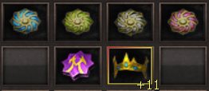

# Cythera Arcana

> **Cythera Arcana.** Explains creating the Cythera Arcana (A), the highest tiara tier, with a level 200+ Celestial or Sub-Celestial, the four secret stones, a Pedra da Fúria, a Cythera M +11 and 1000 fame, at a 50% success rate. It also covers recreating it at the NPC Arcane Jeweler in Kefra from level 241, which takes 2 of each secret stone, 2 Pedras da Fúria, 4 Valkyria emblems and 100kk gold.

## CYTHERA (A) (FAQ WYD Global)

A Chytera (A )é a classe mais alta das tiaras. aumentando consideravelmente seu HP, MP e defesa.

Para criar esse item, são necessários:

* Celestial ou Subcelestial level 200 ou superior
* As 4 pedras secretas (Água,Terra,Sol,Vento)
* Pedra da fúria
* Chythera M +11 ou superior equipada
* 1000 de fama

**Após obter todos os itens em seu inventário basta clicar na pedra da fúria, mas lembre-se a chance de sucesso para essa composição é de 50%, então tome cuidado. Em caso de falha todos os itens serão destruídos com exceção da Cythera M.**

**Boa sorte!**

## CRIAÇÃO DA CYTHERA ARCANA PELA SEGUNDA VEZ (FAQ WYD Global)

Se seu personagem foi adquirido através da negociação entre outro jogador e por isso você não consegue criar a Cythera A, não tem problema! O procedimento pode ser realizado sem novamente da seguinte forma:

* Possuir um Celestial ou Sub-Celestial level 241 ou superior
* 2 pedras secretas de cada elemento
* 2 pedras da Fúria
* 4 emblemas da Valkyria
* 100kk de gold

**OBS: Para realizar o procedimento não é necessário ter uma Cythera M!**

O procedimento é realizado no NPC Arcane Jeweler que fica localizado no final do jardin na cidade perdida de Kefra.

**Sucesso na composição:** Destruição dos itens e criação da Cythera Arcana +11 com 50 de defesa e 70 de HP.

**Falha na composição:** Perda de todos os itens.

A chance de sucesso nesse procedimento é de 50%, então boa sorte!

## Fontes

- [CYTHERA (A)](https://feedback.kersef.com/pt-br/knowledge-bases/21/articles/24106-cythera-a), FAQ WYD Global (feedback.kersef.com). Cópia arquivada: [24106-cythera-a.md](../../sources/feedback_kersef/data/articles/markdown/24106-cythera-a.md)
- [CRIAÇÃO DA CYTHERA ARCANA PELA SEGUNDA VEZ](https://feedback.kersef.com/pt-br/knowledge-bases/21/articles/46277-criacao-da-cythera-arcana-pela-segunda-vez), FAQ WYD Global (feedback.kersef.com). Cópia arquivada: [46277-criacao-da-cythera-arcana-pela-segunda-vez.md](../../sources/feedback_kersef/data/articles/markdown/46277-criacao-da-cythera-arcana-pela-segunda-vez.md)
