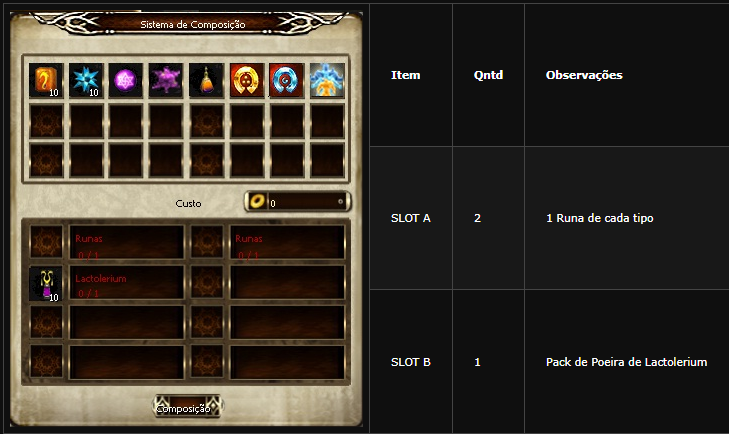
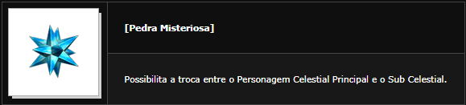

# Sub Celestial

> **Sub-Celestial.** Explains creating a Sub-Celestial from a Celestial of level 120+ using 100 fame, a Sephirot of the chosen class and a Pedra Ideal, then switching between the two with the Pedra Misteriosa made at the NPC Ehre in Erion. It covers the Cythera bonuses the main character gets from the Sub's level and notes that the Sub must relearn all Sephira skills.

## Sub Celestial (FAQ WYD Global)

A partir do level 120 do Celestial, através de uma QUEST específica, o jogador poderá fazer um novo Personagem Celestial e este Sub Celestial começará no level 1. O jogador poderá trocar o seu personagem Celestial dentro do jogo livremente entre o Personagem Celestial e o Sub.

Celestial com a utilização da Pedra Misteriosa.

**Como criar um personagem sub celestial**

O Personagem Celestial deve ser level 120 ou mais.

Pagar uma taxa de 100 de Fame.

Um Sephirot da classe desejada.

Uma Pedra Ideal.

Após equipar o Sephirot, clique na Pedra Ideal, você poderá criar um Sub Celestial e utilizando a Pedra Misteriosa na cidade, você poderá trocar o seu personagem Celestial Principal para o Sub Celestial.

**Como criar a pedra misteriosa**

O Personagem Principal ganha bônus em ataque, atributo e adicionais na Cythera de acordo com o nível do Sub Celestial.

**Adicionais na Cythera**

|  |  |
| --- | --- |
| Bônus de Atributo a Cythera | Atributo |
| Level 121 | +30 Defesa | +40 Força |
| Level 151 | +35 Defesa | +50 Força |
| Level 181 | +45 Defesa | +60 Força |
| Level 200 | +50 Defesa | +70 Força |

Observação: O jogador deve estar equipado com a Cytherea para que o Bônus seja entregue.

## Criação de sub-celestial (FAQ WYD Global)

O sub-celestial é um personagem que divide seu corpo com o celestial.

**COMO CRIAR:**

Para criar o sub-celestial. são necessários:

* Celestial 120+
* 100 de fama
* Sephirot da classe desejada
* pedra ideal

Equipe o sephirot e utilize a pedra ideal. Seu personagem será criado e pode ser selecionado no mesmo personagem celestial.

**ALTERAÇÃO DO PERSONAGEM:**

Para alterar o personagem, é necessário o item: Pedra misteriosa.

Esse item pode ser criado no NPC Ehre em Erion. Entregue duas runas e dez poeiras de Lac e assim, dez pedras misteriosas serão criadas.

**SKILL SEPHIRA:**

O Sub-Celestial deverá aprender todas as Skills Sephira, mesmo se o Celestial já estiver aprendido.

## Fontes

- [Sub Celestial](https://feedback.kersef.com/pt-br/knowledge-bases/21/articles/20383-sub-celestial), FAQ WYD Global (feedback.kersef.com). Cópia arquivada: [20383-sub-celestial.md](../../sources/feedback_kersef/data/articles/markdown/20383-sub-celestial.md)
- [Criação de sub-celestial](https://feedback.kersef.com/pt-br/knowledge-bases/21/articles/22808-criacao-de-sub-celestial), FAQ WYD Global (feedback.kersef.com). Cópia arquivada: [22808-criacao-de-sub-celestial.md](../../sources/feedback_kersef/data/articles/markdown/22808-criacao-de-sub-celestial.md)
