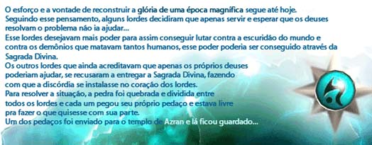
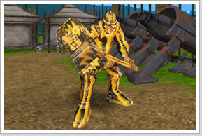
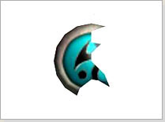
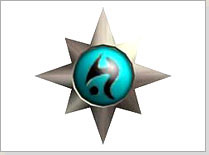

# Benção de Deus

> **Bless of the God.** One-time quest for levels 70-75 north of Erion, started with the Zesty Priest, in which players hunt the NainTrollChief boss for the Pedaço da Chance relic and bring it to the priest Kruno. Kruno turns it into a Composto de Chance, which resets 50 points of skills and learning and cannot be used by Arch characters.

## Benção de Deus (Lv 70~75) (FAQ WYD Global)

**Nine Troll Chief**(Boss)****

**Recompensa**

**Pedaco de Chance**
Ao receber o Pedaço de Chance, entregue-o ao 'Sacerdote Kruno' e ele o transformará em Composto de Chance.
Não permitido para troca, venda, drop
Level Requerido: 70 ~ 75

**Composto de Chance**
Use clicando com o botão direito do mouse.
No ato de uso reinicializa todos os skills e as aprendizagens em 50 pontos.
Não permitido para troca, venda ou drop.
Personagens Arch ou superiores não podem usar esse item.
Level Requerido 70 ~ 75.
Usado apenas 1 vez.

## Benção de Deus (Raid Hut)

**Level 70 ~ Level 75**

*Desde tempos imemoriais, o "Pedaço da Salvação" tem sido uma relíquia venerada, simbolizando a proteção e o poder divino sobre as terras de Erion. A passagem desta relíquia entre as catedrais de Armia e Azran é um evento de grande significância espiritual, marcando um período de renovação e esperança para o povo. O ataque ao sacerdote Kruno e o subsequente roubo da relíquia ameaçam não apenas a paz entre as cidades, mas também o equilíbrio espiritual. A recuperação do "Pedaço da Salvação" não é apenas uma missão de fé, mas também um ato de restauração da ordem divina.*

Level da quest:

- Level 70 ~ Level 75.

Categoria:

- Ajuste de personagem.

Objetivos Detalhados:

- Inicie sua jornada conversando com o NPC Zesty Priest;

- Derrote os monstros NainTrollChief, até dropar o item Pedaço da Chance;

- Fale com o NPC Kruno Priest.

Localizações Importantes:

- A quest fica localizada à norte de Erion (X:2633 Y:1985).

NPCs Importantes:

- NPC Zesty Priest (X:2627 Y:1984);

- NPC Kruno Priest (X:2662 Y:1972).

Recompensas:

- [01] Composto de Chance - Este item singular permite que você resete 50 pontos de aprendizagem de habilidade, zerando todos os skills aprendidos e permitindo uma redistribuição.

Estratégias:

- Para iniciar a quest fale com o NPC Zesty Priest;

- Derrote os monstros NainTrollChief, até dropar o item Pedaço da Chance;

- Após isso, fale com o NPC Kruno Priest, ele irá te recompensar com o item Composto de Chance.

Dicas e Informações:

- Fique ligado que a quest só pode ser realizada uma vez pelo personagem;

- Vale destacar que a quest é reiniciada automaticamente a cada 10 minutos, sempre aos 3 minutos, permitindo uma nova oportunidade de participação.

Perguntas Frequentes:

**E se eu morrer durante a quest?**
Caso você falhe, poderá tentar novamente.

**O item "Pedaço da Chance" é garantido após cada NainTrollChief derrotado?**
O drop do item não é garantido em cada combate. Pode ser necessário derrotar vários NainTrollChief para recuperar o "Pedaço da Chance".

## Fontes

- [Benção de Deus (Lv 70~75)](https://feedback.kersef.com/pt-br/knowledge-bases/21/articles/20370-bencao-de-deus-lv-7075), FAQ WYD Global (feedback.kersef.com). Cópia arquivada: [20370-bencao-de-deus-lv-7075.md](../../sources/feedback_kersef/data/articles/markdown/20370-bencao-de-deus-lv-7075.md)
- [Benção de Deus](https://wydglobal.raidhut.com/#bless-of-the-god), Guia Quest Mortal (Raid Hut). Cópia arquivada: [quests_mortais.md](../../sources/raidhut_quests/data/articles/markdown/quests_mortais.md)
