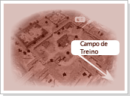
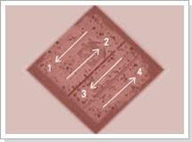
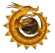
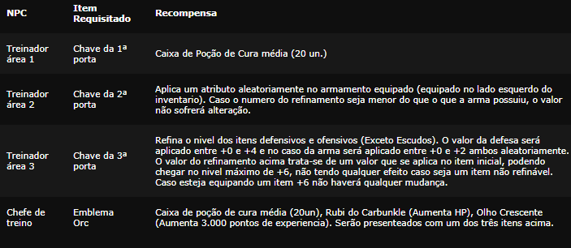

# Campo de Treinamento

> Quest para iniciantes dos níveis 1 a 35 no campo de treinamento a leste de Armia, dividido em quatro áreas cujos bosses (GremlinDecoy, GiantCrill, OrcSniper, OrcWarrior) dropam as chaves para o próximo portão. Os NPCs treinadores (FirstTrainer, SecondTrainer, ThirdTrainer, TrainerChief) dão poções de cura, adicionais aleatórios em armas, refinação até +6 e o item de experiência Olho Crescente, uma vez por personagem.

## Campo de Treinamento (Lv 1~35) (FAQ WYD Global)

**Convite para o novo aventureiro...**

Agora que já tem idade suficiente para carregar uma espada, você deve ter idade suficiente para saber sobre suas responsabilidades. Essas terras podem parecer um paraiso para você, mas não são nada comparadas com a terra que nossos ancestrais viveram, e mesmo esse pouco que temos foi graças ao esforço de bravos e nobres homens que deram a vida para você ter um teto sobre sua cabeça. Agora é a sua vez de nos ajudar a reconstruir a nossa grandeza.

Além destas cercas existem criaturas malignas esperando por uma chance de ameaçar a nossa paz. Nós devemos enfrentá-las juntando as nossas forças em um grande clarão e iluminar este mundo mergulhado na escuridão. Sua força de vontade será o primeiro passo para formar esta única grande luz.

Mas se sair correndo acreditando apenas na sua força de vontade para provar a sua coragem você esta louco! A força de vontade lhe ajudará a juntar a coragem necessária, mas para combater essas criaturas você deve se armar e treinar muito, pois as garras e dentes dessas criaturas podem facilmente dilacerar seu corpo.

---

Não basta apenas ter vontade, você tem que ter conhecimento, saber como usar as suas armas, sejam elas quais forem. Recomendo que vá ao campo de treino antes mesmo de testar a sua coragem. O lugar foi construido principalmente para treinar os futuros guerreiros e exploradores que enfrentarão as criaturas. Para você, que não sabe absolutamente nada sobre a situção deste lugar, será como uma estrela brilhante que ilumina seu caminho numa noite envolta em trevas.

Para aqueles que derrotarem o 'Guerreiro Orc' no campo de treino, nos reconheceremos seu espirito de guerreiro fornecendo itens e equipamentos valiosos e necessários na sua jornada. As criaturas que você deve encontrar pelo caminho do campo de treino são aqueles que nós capturamos. O campo é dividido num total de 4 áreas e para cada área existe um monstro chefe de nivel cada vez mais alto. Em cada área subsequente o ataque e o terror que as criaturas exalam será maior.

Área 1: Javali de guerra, Aguia, Gremlin, Krill, Gremlin Decoy

Área 2: Gremlin, Krill, Rei Gremlin, Serpente, Krill Gigante

Área 3: Gremlin, Krill, Rei Gremlin, Chefe Krill, Orc Sniper

Área 4: Krill, Rei Gremlin, Chefe Krill, Arqueiro Orc, Guerreiro Orc

Para cada área nova, a dificuldade aumenta e as batalhas são mais ferozes, mas não fique desanimado. Cada área conta com um treinador que estão lá para ajudá-lo a evoluir suas técnicas de luta. Os treinadores tem a função de considerar todas as suas condições e necessidades.

Dentre todos os sofrimentos que tera pela frente neste mundo, chegou a hora de conhecer o seu primeiro. Tú és um covarde que foge dos sofrimentos que batem de frente aos teus olhos? Ou um bravo guerreiro que vence todos as adversidades e momentos críticos através do seu espirito de guerreiro?

****

**Recompensa do treinador**

Ao receberem os itens listados abaixo, cada treinador e oficial de treinamento recompensara seus esforcos com itens uteis para o jogo. O personagem tera apenas uma recompensa de cada NPC.

**Atenção**

Somente jogadores abaixo do level 35 podem acessar essa QUEST.

No fim da zona de iniciantes, existem monstros chefes que possuem as chaves dos portões que permitem seguir para a próxima área. A chave pode ser usada apenas uma vez e sumirá no instante do uso. O portão aberto com a chave fechará após algum tempo.

Os treinadores de cada área recompensarão apenas uma vez por personagem.

Caso esteja usando armas em ambas as mãos, o bônus será aplicado apenas na arma do lado esquerdo do inventário.

Quando o treinador da segunda etapa adicionar uma opção aleatoriamente na arma, essa opção será aplicada independentemente da opção original, podendo assim ser aplicada uma opção menor que a inicial.

O treinador da terceira etapa refina os itens de defesa e de ataque e seu valor máximo será de +6. Não terá qualquer efeito caso seu item não seja refinável.

## Campo de Treino (Raid Hut)

**Level 1 ~ Level 35**

*Ao leste de Armia, um campo de treinamento foi estabelecido para forjar os próximos heróis capazes de enfrentar as ameaças crescentes. Sob a orientação dos treinadores mais experientes, novos guerreiros são testados, desafiados e transformados. Cada etapa desta jornada não apenas testará suas habilidades, mas também revelará o verdadeiro valor de um guerreiro. Prepare-se para entrar nesta saga, onde sua determinação, estratégia e coragem serão suas maiores armas.*

Level da quest:

- Level 1 ~ Level 35.

Categoria:

- Up;

- Aprimoramento de equipamentos.

Objetivos Detalhados:

**1ª Etapa**
- Derrote o GremlinDecoy para obter a Chave da Primeira Porta e receba Poções de Cura do FirstTrainer;

**2ª Etapa**
- Vença o GiantCrill, colete a Chave da Segunda Porta e obtenha adicionais aleatórios nas armas com o SecondTrainer;

**3ª Etapa**
- Elimine o OrcSniper, pegue a Chave da Última Porta e aprimore suas armas e armaduras com o ThirdTrainer;

**4ª Etapa**
- Derrote o OrcWarrior, adquira o Emblema Orc e ganhe um bônus significativo de experiência com o TrainerChief.

Localizações Importantes:

- O campo de treinamento se encontra ao leste de Armia, um local preparado especialmente para desenvolver as habilidades dos novos guerreiros. As coordenadas específicas de cada etapa da missão guiarão sua jornada através deste desafio inicial.

**1ª Etapa**
- Primeira Porta (X:2075 Y:2016);

**2ª Etapa**
- Segunda Porta (X:2143 Y:1986);

**3ª Etapa**
- Última Porta (X:2081 Y:1962).

NPCs Importantes:

- Cada um desses personagens tem uma função única, desde equipar você para a batalha até desbloquear o seu potencial através de recompensas significativas.

- NPC Unicorn (X:2130 Y:2040);

- NPC CabuncleWind (X:2131 Y:2033);

- NPC FirstTrainer (X:2077 Y:2017);

- NPC SecondTrainer (X:2144 Y:1989);

- NPC ThirdTrainer (X:2082 Y:1966);

- NPC TrainerChief (X:2122 Y:2041).

Recompensas:

**1ª Etapa**
- [20] Poção de Cura (M);

**2ª Etapa**
- Aplicação de adicionais aleatórios nas armas equipadas;

**3ª Etapa**
- Refinação das armaduras e das armas equipadas;

**4ª Etapa**
- [01] Olho Crescente - Ao utiliza-lo clicando com o botão direito concede ao personagem 3.000 pontos de experiência.

Estratégias:

**Preparação**
- Visitar o NPC Unicorn para adquirir uma arma apropriada à sua classe, se for classe de dano físico comprar armas que dão Aumento de Dano, se for classe de dano mágico comprar armas que dão Ataque Mágico. Em seguida, receba buffs do NPC CabuncleWind para fortalecer seu personagem temporariamente, clicando nele;

**1ª Etapa**
- Derrote o GremlinDecoy (X:2076 Y:2022) para obter a Chave da Primeira Porta e receba [20] Poções de Cura (M) do NPC FirstTrainer, ao interagir com ele. Após isso abra a Primeira Porta e siga para a 2ª etapa;

**2ª Etapa**
- Vença o GiantCrill (X:2146 Y:1997), colete a Chave da Segunda Porta e obtenha adicionais aleatórios nas armas com o SecondTrainer. Após isso abra a Segunda Porta e siga para a 3ª etapa;

**3ª Etapa**
- Elimine o OrcSniper (X:2078 Y:1971), pegue a Chave da Última Porta e aprimore suas armas e armaduras com o ThirdTrainer. Após isso abra a Última Porta e siga para a 4ª etapa;

**4ª Etapa**
- Derrote o OrcWarrior (X:2135 Y:1948), adquira o Emblema Orc e ganhe um bônus significativo de experiência com o TrainerChief.

Dicas e Informações:

- Preste atenção às classes das armas ao comprar do NPC Unicorn, escolher a arma correta pode fazer uma grande diferença;

- Use os buffs do NPC CabuncleWind estrategicamente para maximizar seu desempenho em combate;

- Mantenha-se atento às localizações exatas dos NPCs e portas para não se perder ou perder tempo;

- Aproveite ao máximo as recompensas oferecidas em cada etapa para fortalecer seu personagem;

- Fique ligado que as recompensas dos NPCs são únicas, ou seja, só poderá interagir com cada NPC uma única vez por personagem.

Perguntas Frequentes:

**O que faço se perder uma chave?**
Os monstros continuam dropando as chaves necessárias enquanto você estiver na missão. Basta derrotá-los novamente.

**Posso fazer essa quest após o nível 35?**
 Não, essa missão é exclusiva para personagens do nível 1 ao 35 para garantir um início de jogo equilibrado e desafiador.

## Fontes

- [Campo de Treinamento (Lv 1~35)](https://feedback.kersef.com/pt-br/knowledge-bases/21/articles/20369-campo-de-treinamento-lv-135), FAQ WYD Global (feedback.kersef.com). Cópia arquivada: [20369-campo-de-treinamento-lv-135.md](../../sources/feedback_kersef/data/articles/markdown/20369-campo-de-treinamento-lv-135.md)
- [Campo de Treino](https://wydglobal.raidhut.com/#training-camp), Guia Quest Mortal (Raid Hut). Cópia arquivada: [quests_mortais.md](../../sources/raidhut_quests/data/articles/markdown/quests_mortais.md)
