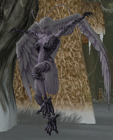
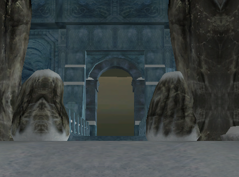
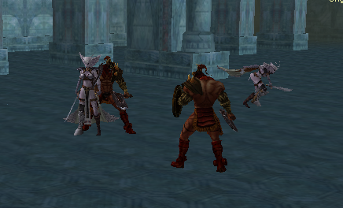
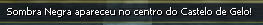
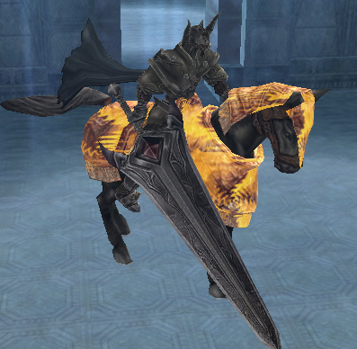
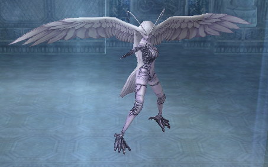

# Rainha Valquíria

> Quest exclusiva para Celestiais e feita em grupo, com quatro etapas e cronômetro de 15 minutos, que começa matando o IceQueen Mirror em Nipleheim e continua no Castelo de Gelo contra monstros invocados e a Sombra Negra. O boss final, Ice Queen Verid, sempre dropa o Coração do Beriel e mais uma recompensa extra, como Alma do Beriel ou Refinação Abençoada +1.

**Quest Rainha Valquíria**

A quest Rainha Valquíria é dividida em quatro etapas com duração total de 15 minutos. Exclusivo para Celestial e só pode ser feita em grupo.

A 1ª parte da quest tem um simples objetivo, encontrar a IceQueen Mirror e matá-la. A Ice Queen se encontra por todo o território de Nipleheim.

Após matar a Ice Queen irá liberar a 2ª parte da quest e dará início a quest, ou seja, a partir desse momento o grupo terá 15 minutos para concluir toda a quest.

A 2ª parte da quest ocorre dentro do Castelo do Gelo e tem como objetivo matar todos os monstros que foram sumonados com a morte da Ice Queen, para assim liberar a 3ª parte da quest.

Um total de 29 monstros ( 9 Berserker Titan, 5 Berserker Ref, 6 Valkyria tina, 5 Valkyria Rosen, 4 Verid).

Ao matar todos os monstros uma mensagem irá aparecer para todos do grupo.

A 3ª parte da quest tem como objetivo matar o temido Sombra Negra que estará localizado no centro do mapa, para então ser sumonado para a última parte.

A 4ª e última parte é eliminar a Ice Queen Verid que estará localizada na segunda sala do mapa.

O drop da IceQueenVerid é 100% “Coração do Beriel” e um dos itens a seguir: [01] Alma do Beriel, [01] Refinação Abençoada +1, [01] Emblema da Proteção, [01] Barra de prata(50kk).

O tempo de duração da quest é de 15 minutos após a morte da IceQueen Mirror.

## Fontes

- [Quest Rainha Valquíria](https://feedback.kersef.com/pt-br/knowledge-bases/21/articles/25266-quest-rainha-valquiria), FAQ WYD Global (feedback.kersef.com). Cópia arquivada: [25266-quest-rainha-valquiria.md](../../sources/feedback_kersef/data/articles/markdown/25266-quest-rainha-valquiria.md)
