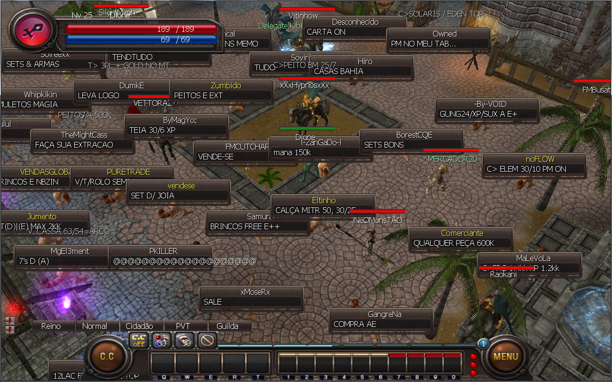
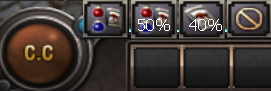
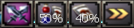
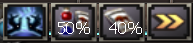
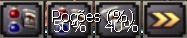

# Modo C.C. (Controle de Combate/Macro)

> Explica o Modo C.C., o macro de combate automático que ataca ou usa skills nos monstros ao alcance, ativa os buffs do primeiro slot de atalho e usa poções ou alimenta a montaria automaticamente em porcentagens de HP definidas; ele nunca ataca outros jogadores.

O modo C.C. é um sistema de ataque automático que faz com que o seu personagem ataque ou utilize magias automaticamente quando um monstro entra no seu raio de ataque.
O Modo C.C. também permite que os jogadores conversem pelo Chat enquanto caçam.

**Ao conectar-se no jogo, o Modo C.C. estará desligado. Você pode escolher qual modo você quer utilizar clicando no botão C.C.**

**Como usar o C.C. Mode**

Você pode colocar as skills de buff no 1º slot da barra rápida enquanto usa o C.C. Mode para fazer seu personagem usar o buff.

|  |  |
| --- | --- |
|  | **[Controle de Combate]** Você pode escolher o controle de combate físico clicando no botao C.C. e a personagem irá automaticamente as usar todas as skills de Buff da primeira barra rápida e o personagem irá atacar fisicamente todos os monstros que estiverem dentro do seu raio de ataque. |
|  | **[ Combate Mágico ]** Você pode escolher o controle de combate mágico clicando no botao C.C. e personagem irá automaticamente utilizar todas as skills de Buff da primeira barra rápida e então a personagem irá atacar os monstros com as skills que estiverem abaixo da barra de ataque automático(barra vermelha) |
|  | **[ Modo Passivo ]** Você pode escolher o controle de combate passivo clicando no botao C.C. e a personagem irá automaticamente utilizar todas as skills de Buff e então utilizará as poçóes e rações de montaria quando necessário |

**Observações:**
Personagem irá atacar automaticamente ou usar skills dependendo do raio de ataque.
Personagem irá usar poções automaticamente quando o seu HP baixar a um certo por cento.
Personagem irá usar rações automaticamente quando o HP da montaria baixar a um certo por cento.
Modo C.C. não ataca outros jogadores caso você esteja caçando em uma área PK mesmo com o Modo PK ativo.

## Fontes

- [Modo C.C. (Controle de Combate/MACRO)](https://feedback.kersef.com/pt-br/knowledge-bases/21/articles/20396-modo-cc-controle-de-combatemacro), FAQ WYD Global (feedback.kersef.com). Cópia arquivada: [20396-modo-cc-controle-de-combatemacro.md](../../sources/feedback_kersef/data/articles/markdown/20396-modo-cc-controle-de-combatemacro.md)
