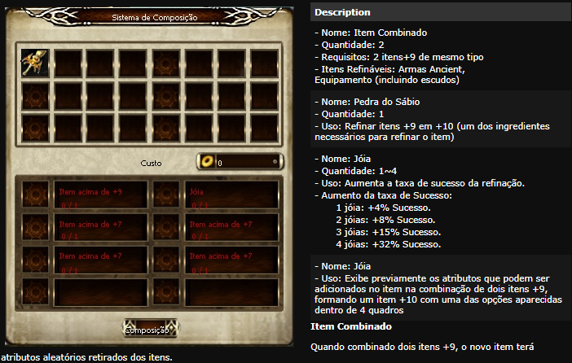
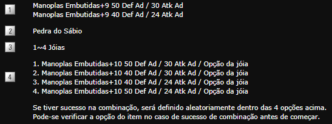
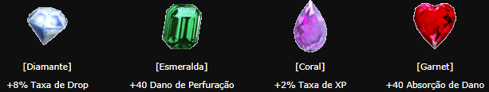
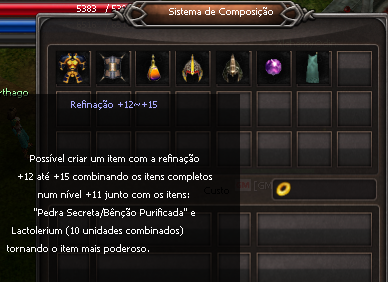
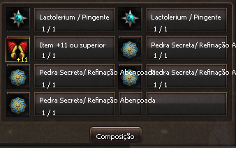
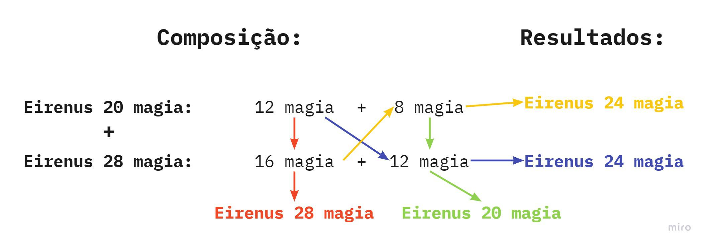
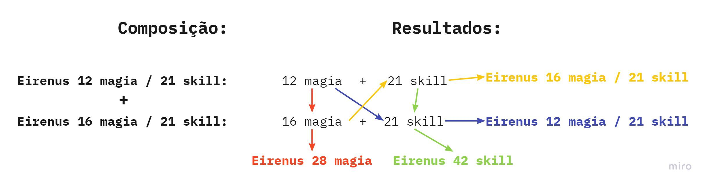
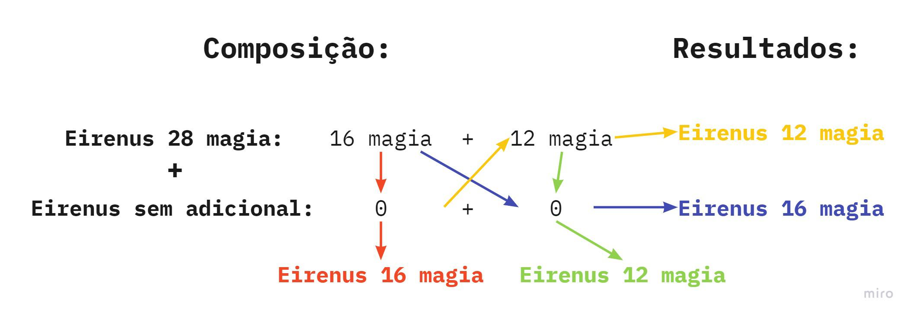

# Sistema de Refinação

> **Refinement System.** Covers item refinement from +0 to +11 using Poeira de Oriharucon and Lactorerium, the Ancient weapon path, +10 composition at NPC Alieen in Azran with jewel effect gems, and +12 to +15 composition at Alquimista Odin in Kefra city with fixed success rates of 4% to 1%.

## Sistema de Refinação +0 a +11 (FAQ WYD Global)

Com exceção dos itens marcados como ''impossível de refinar'', todas as armas e armaduras podem ser refinadas através de Poeira Oriharucon e Poeira Lactorerium. Se você refinar seus itens usando o Poeira Oriharucon e Poeira Lactorerium, +(número) e marcado seguindo o nome do item. Quando sua refinação aumenta, o poder de ataque do item, o poder defensivo e a opção adicional são também aumentados em 10% e outra opção de bônus será adicionado se você for hábil para refinar seus equipamentos para o level 9. E também, quanto mais alta a classe das suas armas e armaduras, maior a dificuldade para refiná-las. Os itens de classes baixas têm maior taxa de sucesso. Quando a refinação do item aumenta, a taxa de sucesso de refinação abaixa, resultando no aumento do consumo da poeira.

**Itens de defesa e armas podem ser refinadas, com a diferença que armas exigem um processo mais longo no qual se deve passar para Ancient antes de poder refinar para +10, diferente de armaduras.**

**Refinação de armas:**

Armas tem um processo maior, em que se faz necessário refinar ela até +9 normalmente e logo depois torná-la Ancient, através do NPC Compositor. Ao fazer isto, op item voltará a um valor de refinação +7, fazendo-se necessário refiná-la até +9 novamente.
Logo após refinar duas armas ao nível Ancient +9, você poderá tentar uni-las para obter uma com refinação de nível +10!

**> Refinação +10**

O sistema é parecido com a formação de item Ancient, para refinar será necessário juntar dois itens +9 e fundir para formar um item +10.

Com a base das opções dos dois itens +9, a opção do item combinado de +10 é definida.

Pela mesma forma de um item Ancient, a opção adicional de um item combinado pode variar de acordo com a jóia (pedra/gema) usada, pode-se fabricar um item que ultrapasse as opções do item +9. No caso de um item Ancient, apenas as armas podem ser combinadas, mas no caso de refinamento de um item para o nível +10, podem ser combinados tanto as armas quanto as defesas. Para formar um item combinado para o nível +10 é necessário o uso de um item chamado de ''Pedra do Sábio''. **> Combinação de itens**

Pode formar um item +10 através da ''Aileen'' da cidade de Azran, é necessário dois itens com mesmo nome no nivel +9 e 50 milhões de gold para a combinação.

**Exemplo**

Item necessário para refinar um item para +10.

**Jóias**

Aumenta a probabilidade de sucesso na combinação. Possível a utilização do mesmo tipo de jóia.

**Item permitido para combinação: Armas Ancient, Defesa (incluindo Escudos)**

**Observações:**

* A opção base do item aumenta, mas as opções bônus não são afetadas.
* Apenas os itens do tipo como Normal, Místico, Arcano, Legendário e Ancient são permitidos para a combinação. No caso de item Ancient, permitido apenas os que foram fabricados pelas mesmas jóias.
* Para combinar é necessário ter 50 milhoes de gold.
* Em caso de sucesso um item +10 irá aparecer no seu inventário e se houver falha, os 2 itens +9 permanecerão, mas o resto dos ingredientes irão desaparecer.
* Em caso de sucesso um item +10 irá aparecer no seu inventário e se houver falha, os 2 itens +9 permanecerão, mas o resto dos ingredientes irão desaparecer.
* Caso haja sucesso na combinação dos itens, você terá um atributo adicional a sua arma baseada na jóia utilizada.
* Caso haja falha, os 2 itens +9 permanecerão, mas o resto dos ingredientes irão desaparecer.
* A combinação pode ser feita apenas nas armas Ancient e defesa (Inclusive escudo), mas os acessórios não podem ser combinados. Armas normais padrões não podem ser combinadas.

**> Refinação +11**

Ao conseguir sucesso nesta composição para +10, utilizando-se a Poeira de Lactolerium, você poderá refiná-la até o nível +11.
Ao concluir estes passos, estará apto a tentar refinar para +12.

Para itens de defesa, inclusos escudos, o processo é mais simples, bastando refinar 2 itens até +9 e seguir o mesmo processo para +10 e +11.

## Sistema de Refinação +12 a +15 (FAQ WYD Global)

A composição é feita através do NPC Alquimista Odin, que se encontra no Continente Desconhecido (Cidade do Kefra)

Itens necessários para composição:

\* 1 Item +11 ou superior (Ancient no caso de armas)

\* 4 pedras secretas aleatórias ou 4 refinações abençoadas;

\* 2 Pacs de Lac com 10 unidades ou 2 Emblemas da proteção;

Obs1: Caso a composição seja feita com Pac de Lac, existe uma pequena chance do item ser destruído caso não tenha sucesso. Neste caso, o jogador perderá o item por completo.

Obs2: Usando-se 2 Emblemas da proteção, em caso de falha, a opção adicional do item torna-se um cristal de extração, dando-se a possibilidade de salvar as opções adicionais de qualquer item, seja ele arma ou item de defesa.

Se obter sucesso, todos os itens usados serão destruídos e restará somente o item +12 (ou superior). Em caso de falha, todos os itens serão destruídos, e o item +11 ou superior terá sua refinação reduzida em 1 nível, ou seja, de +11 ele pode voltar para +10, de +14 ele pode voltar para +13, etc.

**Chance de sucesso:**

Cada refinação possui uma chance fixa de sucesso:

+12 = 4%
+13 = 3%
+14 = 2%
+15 = 1%

Além da chance fixa, cada Pedra Secreta ou Refinação Abençoada dará uma bonificação de sucesso para a composição:

Pedra secreta: 1% de chance por unidade.

Ex: Composição de um item de +11 para +12 com 4 Pedras Secretas = 4% da chance fixa + 4%  (1% de cada Pedra Secreta) = **8% de chance de sucesso.**

**Refinação Abençoada (unidade):**

+0 > 2%
+1 > 3%
+2 > 4%
+3 > 5%
+4> 6%
+5 > 7%
+6> 8%
+7 > 10%
+8 > 12%
+9 > 15%

Ex1: Composição de um item de +11 para +12 com 4 refinações abençoadas +0 = 4% de chance fixa + 8% (2% de cada refinação abençoada) = **12% de chance de sucesso.**

Ex2: Composição de um item de +12 para +13 com 4 refinações abençoadas +3 = 3% de chance fixa + 20% (5% de cada refinação abençoada +3) = **23% de chance de sucesso.**

**IMPORTANTE: Ao utilizar 1 refinação+1 na composição, o item não corre o risco de virar extração e cada emblema utilzado nessa composição concede 1% de sucesso na refinação do item.**

## REFINAÇÃO +10 E MUDANÇA DE ADICIONAIS (FAQ WYD Global)

Para refinar um item para "+10", vá até a cidade de Azran e encontre o NPC Alieen (X:2529 Y:1725).

Itens necessários:

• [02] Itens +9 iguais e do mesmo tipo (N, M, A, Le ou Anct).

• [04] jóias iguais

• [30] Poeiras de Lac

• 5.000.000 gold

**Sucesso:**

Todos os itens utilizados para composição serão destruídos e você receberá um item +10.

**Falha:**

Jóias, pedra do sábio e o Gold serão perdidos.

---

**GEMA DE EFEITO**

É possível definir um efeito extra para itens +10 (ou superior), em função da jóia utilizada na composição.

Diamante: 8% na Taxa de Drop

Esmeralda: 40 Pontos de perfuração

Coral: 2% na Taxa de Experiência.

Garnet: 40 pontos de absorção de Dano.

Obs: Caso o item escolhido para composição seja uma arma Anct, os efeitos das armas terão que ser iguais e as jóias utilizadas terão que ser compatíveis com o efeito.

Ex: As duas armas com efeito de 8% de drop e 4 diamantes.

---

##### COMPOSIÇÃO DE ADICIONAIS

Toda arma no jogo possui **dois adicionais internos**, mesmo que apenas um seja visível no sistema do jogo.

###### Exemplo 1: Eirenus com adicional de Magia

* **Eirenus 28 Magia**: internamente possui 12 Magia + 16 Magia
* **Eirenus 20 Magia**: internamente possui 12 Magia + 8 Magia

> Mesmo que o jogo exiba apenas um valor, ele é composto por dois adicionais fixos. Esses adicionais sempre respeitam combinações válidas existentes no sistema. Portanto, não existem combinações como "10 Magia", já que esse valor não é composto por dois adicionais válidos.

###### Exemplo 2: Eirenus com Magia e Skill

* **Eirenus 12 Magia / 21 Skill**
* **Eirenus 16 Magia / 21 Skill**

> Neste caso, a arma apresenta **dois adicionais de categorias diferentes**, por isso ambos são exibidos.

###### Exemplo 3: Eirenus com dois adicionais baixos

* **Eirenus 12 Magia / 8 Magia**

> Armas com adicionais baixos também seguem a regra de dois adicionais internos. Nesse caso, é possível que um dos valores esteja zerado (invisível para o jogador).

###### Possíveis composições internas:

* 12 + 8 = **20% Magia**
* 12 + 0 = **12% Magia**
* 8 + 0 = **8% Magia**
* 0 + 0 = **0% Magia**

---

**ENTENDENDO MELHOR:****EXEMPLO 1:**

Vamos supor que que iremos compor uma Eirenus +10 através de 2 Eirenus +9, cujo adicionais são: 20 magia e 28 magia. Quais os adicionais a minha arma pode receber?

Os adicionais de uma Eirenus cruzará com os adicionais da outra Eirenus, possibilitando os adicionais:

* 12 + 16 = 28
* 12 + 12 = 24
* 8 + 16 = 24
* 8 + 12 = 20

---

**EXEMPLO 2:**

Os adicionais utilizados desta vez, são: 12 magia / 21 Skill e 16 magia / 21 Skill. Nesse caso os adicionais podem ser iguais aos das armas apresentados ou os adicionais iguais das duas armas podem ser somados (Magia + Magia ou Skill + Skill.).

Possibilidades:

* 12 + 21 = 12/21
* 16 + 21 = 16/21
* 12 + 16 = 28 magia
* 21 + 21 = 42 skill

---

**EXEMPLO 3:**

Caso uma das armas utilizadas não possua adicional: Eirenus 28 base + Eirenus sem adicional:

Possibilidades:

* 12 + 0 = 12
* 16 + 0 = 16
* 0 + 16 = 16
* 0 + 12 = 12

**IMPORTANTE: ALÉM DOS EXEMPLOS CITADOS, AS ARMAS PODEM ADQUIRIR O ADICIONAL DE UMA DAS DUAS ARMAS SEM SOMAR O DAS DUAS.**

**EXEMPLOS:**

**1. Eirenus 8 base de ataque magico e Eirenus 42 skill -  A arma pode ficar com 8 ou 42.****2. Eirenus sem adicional (base 0) e Erinus  28 base - A Arma pode ficar com 0 ou 28 (além dos outros adicionais informados acima.**

## Fontes

- [Sistema de Refinação +0 a +11](https://feedback.kersef.com/pt-br/knowledge-bases/21/articles/21072-sistema-de-refinacao-0-a-11), FAQ WYD Global (feedback.kersef.com). Cópia arquivada: [21072-sistema-de-refinacao-0-a-11.md](../../sources/feedback_kersef/data/articles/markdown/21072-sistema-de-refinacao-0-a-11.md)
- [Sistema de Refinação +12 a +15](https://feedback.kersef.com/pt-br/knowledge-bases/21/articles/22542-sistema-de-refinacao-12-a-15), FAQ WYD Global (feedback.kersef.com). Cópia arquivada: [22542-sistema-de-refinacao-12-a-15.md](../../sources/feedback_kersef/data/articles/markdown/22542-sistema-de-refinacao-12-a-15.md)
- [REFINAÇÃO +10 E MUDANÇA DE ADICIONAIS](https://feedback.kersef.com/pt-br/knowledge-bases/21/articles/23123-refinacao-10-e-mudanca-de-adicionais), FAQ WYD Global (feedback.kersef.com). Cópia arquivada: [23123-refinacao-10-e-mudanca-de-adicionais.md](../../sources/feedback_kersef/data/articles/markdown/23123-refinacao-10-e-mudanca-de-adicionais.md)
